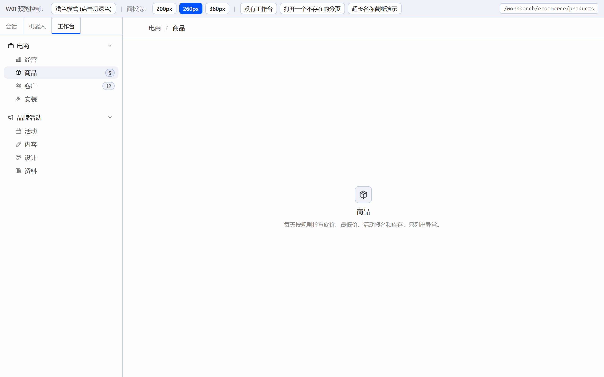
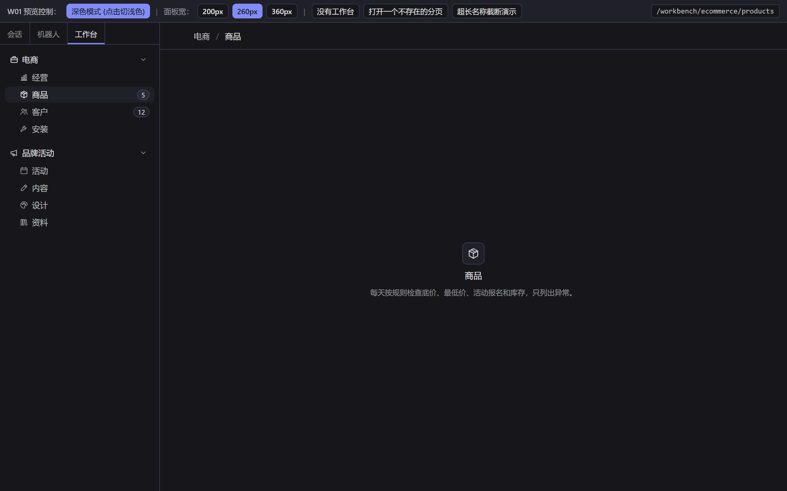
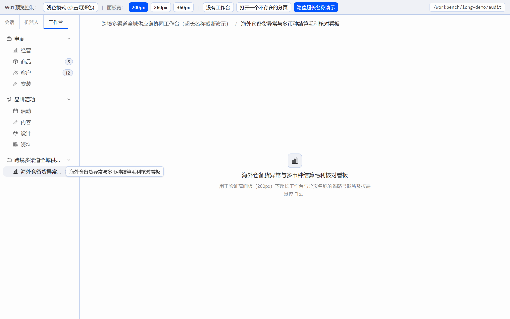

# W01 交付报告：工作台框架（左上角“工作台”标签 + 页面外壳）

## 一、交付物清单与构建验证

本次交付完成 W01 任务卡要求的全部工作台框架代码与预览环境：

| 交付文件 | 说明 | 状态 |
|---|---|---|
| `package.json` / `tsconfig.json` / `vite.config.ts` | React 19 + Vite 6 + TypeScript + Tailwind v4 预览工程配置，将 `@hermes/plugin-sdk` 别名映射到 `preview/sdk-stub.tsx` | ✅ 已完成 |
| `src/types.ts` | 原样使用任务卡给定的 `WorkbenchPageDef`、`WorkbenchDef`、`WorkbenchLocation` 接口定义，未改动任何字段 | ✅ 已完成 |
| `src/registry.ts` | 基于 React 原生 `useSyncExternalStore` 实现的工作台注册表与位置管理（`registerWorkbench`、`listWorkbenches`、`useWorkbenches`、`useLocation`、`openPage`、`setNavigator`、`parsePath`、`toPath`），无任何第三方状态库 | ✅ 已完成 |
| `src/WorkbenchPane.tsx` | 左栏“工作台”面板：两级折叠树（工作台 → 分页）、`localStorage` 持久化展开状态（带 `try/catch`）、收起分组时汇总待办数与当前位置高亮、按需测量截断后悬停 `Tip`、悬停立即变色且离开 100ms 淡出、支持 `prefers-reduced-motion`、无工作台时渲染 `EmptyState` | ✅ 已完成 |
| `src/WorkbenchPage.tsx` | 主区域页面外壳：顶部 `工作台名 / 分页名` 面包屑（工作台名为次要文字色，点击跳回该工作台第一页）、右侧预留 `<div data-slot="actions" />`、对齐 `PAGE_INSET_X` 左右留白、页面不存在时渲染 `ErrorState`（“找不到这个页面” + “回到工作台首页”按钮） | ✅ 已完成 |
| `src/modules/ecommerce.tsx` | 电商工作台模块：经营（`graph`）、商品（`package`，`badge: () => 5`）、客户（`organization`，`badge: () => 12`）、安装（`tools`）4 个分页及对应业务说明 `EmptyState` | ✅ 已完成 |
| `src/modules/brand.tsx` | 品牌活动工作台模块：活动（`calendar`）、内容（`edit`）、设计（`symbol-color`）、资料（`library`）4 个分页及对应业务说明 `EmptyState` | ✅ 已完成 |
| `src/plugin.tsx` | Hermes 插件入口：注册左栏 `panes` 贡献、注册 `ROUTES_AREA` 路由贡献、注入 `host.navigate`、同步 Hash 路由位置，并在初始化时注册电商与品牌活动两个工作台 | ✅ 已完成 |
| `preview/` | `sdk-stub.tsx`、`index.html`、`main.tsx`：模拟 Hermes 左栏“会话 \| 机器人 \| 工作台”标签条 + 主区域，顶部工具栏支持切换浅色/深色、200/260/360px 面板宽、无工作台空状态、打开不存在的分页、超长名称截断演示 | ✅ 已完成 |

- **构建与类型检查**：执行 `npm run build`（`tsc --noEmit && vite build`）零错误通过。
- **模块图标选型说明**：
  - 电商工作台顶层图标选用 `briefcase`（避免与子分页“商品”的 `package` 图标重复），4 个子分页依次为 `graph`（经营）、`package`（商品）、`organization`（客户）、`tools`（安装）。
  - 品牌活动工作台顶层图标选用 `megaphone`，4 个子分页依次为 `calendar`（活动）、`edit`（内容）、`symbol-color`（设计）、`library`（资料）。

---

## 二、视觉预览与对比截图

### 1. 浅色模式（260px 默认面板宽）


### 2. 深色模式（260px 默认面板宽）


### 3. 窄面板（200px 面板宽 + 超长名称省略号截断与按需悬停 `Tip`）


### 4. 与本机 Hermes 桌面版侧栏会话列表并排对比
> 注：`w01-light.png`、`w01-dark.png`、`w01-narrow-200px.png` 三张预览截图已随本次提交入库；与本机 Hermes 桌面版侧栏会话列表的并排对比截图（`w01-hermes-compare.png`）暂缺，将在后续补齐。

---

## 三、`/impeccable critique` 审查结论与据此修改的内容

在完成初版实现后，对照 `impeccable` 技能的 `critique.md`（Nielsen 启发式、认知负荷、视觉层级）与 `craft-floor.md`（间距对比、状态完备性、原生桌面控件手感）以及 Hermes `apps/desktop/DESIGN.md` 执行了审查：

### 1. 硬性视觉规范核查（全部通过）
- **零写死颜色**：`src/` 下所有组件仅引用 `--ui-text-primary/secondary/tertiary/quaternary`、`--ui-accent`、`--ui-stroke-secondary`、`--ui-bg-quinary`、`--ui-bg-editor`，无任何 `#hex`、`rgb()` 或 Tailwind 固定色板类。
- **严禁误用强调色填充当背景**：`src/` 全目录未使用 `--ui-bg-primary` 或 `--ui-bg-secondary`。
- **严守导入白名单与无任意值 Tailwind 类**：`src/` 组件仅导入 `react` 与 `@hermes/plugin-sdk`（仅用 `Button, Badge, Codicon, Tip, EmptyState, ErrorState, cn`），所有精细尺寸与动效均写在 `<style>` 块的 `wb-` 前缀样式类中。

### 2. Critique 发现的 3 个问题及据此完成的修改

1. **左栏工作台分组间距层级与折叠态“系统状态可见性”（Heuristic #1: Visibility of System Status & Craft-Floor Spacing）**
   - **问题**：初版 `<nav>` 的分组间距与组内行距接近，多个工作台同时展开时组间层次不够分明；此外，当用户处于“电商 / 商品”页并收起“电商”工作台时，子分页隐藏后左栏失去了当前激活位置指示，且组内的待办数（商品 `5` + 客户 `12` = `17`）也随之不可见。
   - **据此修改**：
     - 将 [`WorkbenchPane.tsx`](../../src/WorkbenchPane.tsx) 中工作台分组间的间距调整为 `gap-3`，组内子分页保持 `gap-0.5`，形成清晰的“组内紧凑、组间呼吸”节奏。
     - 在 `WorkbenchGroup` 中计算 `hasActivePage` 与折叠态汇总待办数 `collapsedBadgeTotal`：当工作台被收起（`!expanded`）时，若当前路由位于该工作台下，则在工作台分组头上显示 `data-active="true"` 高亮背景；若该工作台下有待办数，则在折叠的分组头右侧显示汇总徽标（`17`），对齐 Chatwoot 侧栏分组折叠的未读数交互。

2. **主区域面包屑页头的高度稳定性与桌面交互手势（Heuristic #4: Consistency and Standards）**
   - **问题**：初版 [`WorkbenchPage.tsx`](../../src/WorkbenchPage.tsx) 页头高度完全由面包屑文字撑开（`py-2.5`），后续任务卡向右侧 `<div data-slot="actions" />` 注入操作按钮（`Button`）时，按钮高度会撑高页头导致不同分页切换时页头底部分割线发生 2–4px 跳动。
   - **据此修改**：
     - 在 [`WorkbenchPage.tsx`](../../src/WorkbenchPage.tsx) 中新增 `.wb-page-header { min-height: 2.75rem; }`，保证无论右侧 `data-slot="actions"` 是否挂载按钮，页头高度始终稳定在 `44px`。
     - 为 `.wb-pane-row`、`.wb-caret-btn`、`.wb-breadcrumb-link` 显式补充 `cursor: pointer`，提升桌面端可点击区域反馈。

3. **与 Hermes 原生 SDK `Badge` 枚举契约及插件生命周期方法对齐**
   - **问题**：初版 `Badge` 传入了 `variant="secondary"`，而核对 Hermes 源码 `apps/desktop/src/components/ui/badge.tsx`（第 12–22 行），原生 `Badge` 的 `variant` 枚举为 `'default' | 'muted' | 'success' | 'warn' | 'destructive' | 'outline' | 'solid'`；同时任务卡描述为“在插件 setup 里注册”，而 Hermes 插件宿主（`apps/desktop/src/contrib/plugin.ts` 第 195–212 行）实际调用的是 `register(ctx)`。
   - **据此修改**：
     - 将 [`WorkbenchPane.tsx`](../../src/WorkbenchPane.tsx) 中的 `Badge` `variant` 改为 `'outline'`（搭配 `bg-(--ui-bg-quinary)` 与 `border-(--ui-stroke-secondary)`），并在 [`preview/sdk-stub.tsx`](../../preview/sdk-stub.tsx) 中兼容该枚举。
     - 在 [`src/plugin.tsx`](../../src/plugin.tsx) 默认导出对象上同时暴露 `setup: setupWorkbenchPlugin` 与 `register: setupWorkbenchPlugin`，并通过 `ctx.onDispose?.(cleanup)` 注册清理函数。

---

## 四、`plugin.tsx` 及组件参考 Hermes 源码的具体行号对照

以下行号均对应本机 `hermes-agent` 仓库 `apps/desktop/` 下的源码：

| 实现模块 | 参考的 Hermes 源码文件与精确行号 | 照抄/对齐的具体写法 |
|---|---|---|
| **左栏面板注册**（[`src/plugin.tsx`](../../src/plugin.tsx)） | `apps/desktop/src/plugins/hermes-bots/plugin.tsx` **第 445–487 行**（插件入口结构见 **第 112–117 行**） | `ctx.register({ id: 'pane', area: 'panes', title: '工作台', data: { placement: 'left', width: '260px', collapsible: true, hideOnly: true, tabTitle: () => '工作台', tabTitleText: () => '工作台', dock: { pane: 'sessions', pos: 'center', enforce: true } }, render: () => <WorkbenchPane /> })`。其中 `dock: { pane: 'sessions', pos: 'center', enforce: true }` 使面板叠入左栏 `sessions` 区域，形成“会话 \| 机器人 \| 工作台”并排标签条。 |
| **页面路由注册**（[`src/plugin.tsx`](../../src/plugin.tsx)） | `apps/desktop/src/plugins/kanban/plugin.tsx` **第 107–113 行**（插件入口结构见 **第 81–86 行**） | `area: ROUTES_AREA`，`data: { path } satisfies RouteContribution`，`render: () => <WorkbenchPage />`。 |
| **编程式路由跳转**（[`src/plugin.tsx`](../../src/plugin.tsx)） | `apps/desktop/src/sdk/index.ts` **第 642–654 行** | 调用 `host.navigate(path)`（其内部将路径写入 `window.location.hash = '#' + to` 并调用 `syncWorkspaceRoute(to)`）。 |
| **主区域左右留白 `PAGE_INSET_X`**（[`src/WorkbenchPage.tsx`](../../src/WorkbenchPage.tsx)） | `apps/desktop/src/app/layout-constants.ts` **第 9 行** | 源码定义为 `export const PAGE_INSET_X = 'px-[clamp(1.25rem,4vw,4rem)]'`。为遵守“不用任意值 Tailwind 类”规范，在 `.wb-page-inset` 中使用等价的 `padding-inline: clamp(1.25rem, 4vw, 4rem)`。 |
| **左栏列表行字号、行高与图标槽位**（[`src/WorkbenchPane.tsx`](../../src/WorkbenchPane.tsx)） | `apps/desktop/src/app/chat/sidebar/row-geometry.ts` **第 25–55 行**、`chrome.tsx` **第 180–239 行**、`components/ui/disclosure-caret.tsx` **第 11–20 行** | 行最小高度 `1.625rem`（26px，`SIDEBAR_ROW_MIN_H` 第 25 行）、字号 `0.8125rem`（13px，`SIDEBAR_ROW_LABEL` 第 46 行）、行高 `1.35`（`SIDEBAR_TRUNCATED_LEADING` 第 44 行）、前置图标槽位 `0.875rem × 0.875rem`（`SIDEBAR_ROW_LEAD` 第 32 行、`SIDEBAR_LEAD_ICON_SIZE` 第 55 行）、展开箭头 `chevron-right` `0.75rem` 顺时针旋转 90°（`DisclosureCaret` 第 11–20 行）。 |
| **悬停立即变色、离开 100ms 淡出**（[`src/WorkbenchPane.tsx`](../../src/WorkbenchPane.tsx)） | `apps/desktop/DESIGN.md` **第 490–496 行** | 常态设置 `transition: background-color 100ms ease-out, color 100ms ease-out`，`:hover` 设置 `transition: none`，并包含 `@media (prefers-reduced-motion: reduce)`。 |
| **预览环境 CSS 变量表**（[`preview/index.html`](../../preview/index.html)） | `apps/desktop/src/styles.css` **第 203–394 行**（浅色 `:root`）、**第 602–630 行**（深色 `:root.dark`） | 原样照抄 `--theme-*` 种子色与 `--ui-bg-*`、`--ui-text-*`、`--ui-stroke-*` 的 `color-mix(in srgb, ...)` 计算公式。 |

---

## 五、Hermes 路由不支持通配符 & 缺失“读取当前路径”SDK 接口的排查与处理

### 1. 为什么 Hermes 的 `ROUTES_AREA` 路由不支持 `/workbench/*` 通配符？
- **源码定位**：
  1. `apps/desktop/src/app/routes.ts` **第 88–94 行**：`RouteContribution` 注释明确写明 `/** Absolute path, e.g. '/kanban'. One segment; no params. */`。
  2. `apps/desktop/src/app/routes.ts` **第 119–121 行**：
     ```ts
     function isContributedPath(pathname: string): boolean {
       return contributedRoutes().some(route => route.path === pathname)
     }
     ```
     尽管 `apps/desktop/src/app/contrib/surfaces.tsx` **第 204–214 行**将 `route.path.slice(1)` 传给了 React Router 的 `<Route path={...} />`，但宿主在 `appViewForPath(pathname)`（`routes.ts` **第 237–249 行**）和 `isWorkspacePageRoute(pathname)`（**第 254–258 行**）中依赖 `isContributedPath(pathname)` 的 `route.path === pathname` **严格字符串全等判断**来决定是否将主工作区切换到插件页面（`$workspaceIsPage`）。
  3. 如果只注册一条 `/workbench/*`，访问 `/workbench/ecommerce/overview` 时 `isContributedPath` 返回 `false`，宿主会将其误判为普通聊天路由（`'chat'`），导致主区域无法切换到工作台页面。
- **处理方式**：在 [`src/plugin.tsx`](../../src/plugin.tsx) 中遍历所有已注册工作台的所有分页，**为每个工作台的每个分页显式注册一条精确路由**（如 `/workbench/ecommerce/overview`、`/workbench/ecommerce/products` 等共 8 条），同时额外保留一条 `/workbench/*` 兜底路由。

### 2. SDK 中未找到“读取当前路由路径”接口的排查与猜测
- **排查过程**：
  - 完整检查了 `apps/desktop/src/sdk/index.ts` 中 `host.state`（**第 559–605 行**）暴露的全部只读 nanostore atoms（仅包含 `activeSessionId`、`awaitingResponse`、`busy`、`busyBySession`、`connectionId`、`cwd`、`focusedSessionId`、`focusedSessionOwner`、`focusedSessionProfile`、`focusedStoredSessionId`、`focusedUsage`、`gateway`、`model`、`profile`、`viewport`）以及文件末尾（**第 1540–1991 行**）的所有导出项。
  - **结论**：当前版本的 `@hermes/plugin-sdk` 提供了跳转接口 `host.navigate(path)`（**第 642–654 行**），但**确实没有对外导出读取当前路由路径的 atom（如 `host.state.pathname`）或 `useLocation` Hook**（因为内置的 `kanban` 插件是单路径 `/kanban`，无需读取子路径参数）。
- **我的猜测与当前过渡方案**：
  - 从 `apps/desktop/src/sdk/index.ts` **第 646 行** `window.location.hash = '#' + to` 可以确定，Hermes 桌面端渲染进程使用的是基于 `window.location.hash` 的 `HashRouter`。
  - 因此在 [`src/registry.ts`](../../src/registry.ts) 和 [`src/plugin.tsx`](../../src/plugin.tsx) 中，我们采用了双保险机制：
    1. 点击左栏分页调用 `openPage(loc)` 时，内部状态立即通过 `useSyncExternalStore` 更新并触发 `host.navigate(toPath(loc))`。
    2. 初始化及浏览器前进/后退或外部调用 `host.navigate` 时，通过读取 `window.location.hash.replace(/^#/, '')` 并监听 `window.addEventListener('hashchange', ...)` 自动调用 `syncLocationFromPath` 同步当前工作台与分页。
  - 若后续要在 Hermes SDK 中正式补齐该接口，只需在 `apps/desktop/src/sdk/index.ts` 的 `host.state` 中新增一行只读 atom（或者在宿主 `syncWorkspaceRoute` 时更新该 atom）即可。
