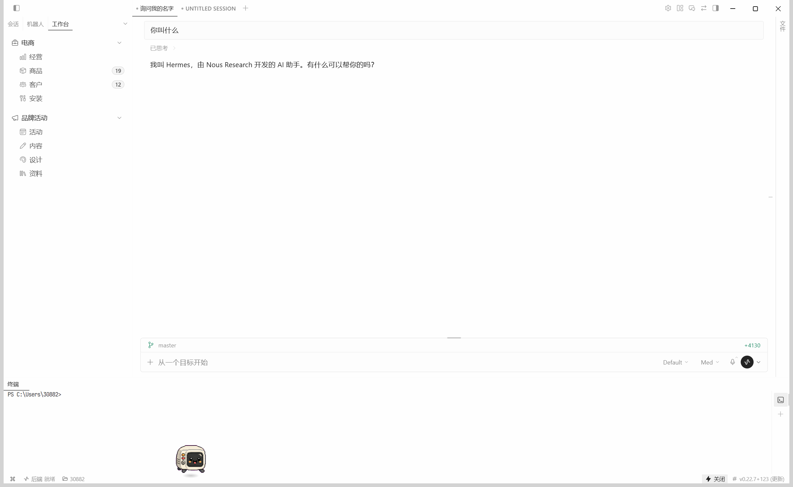
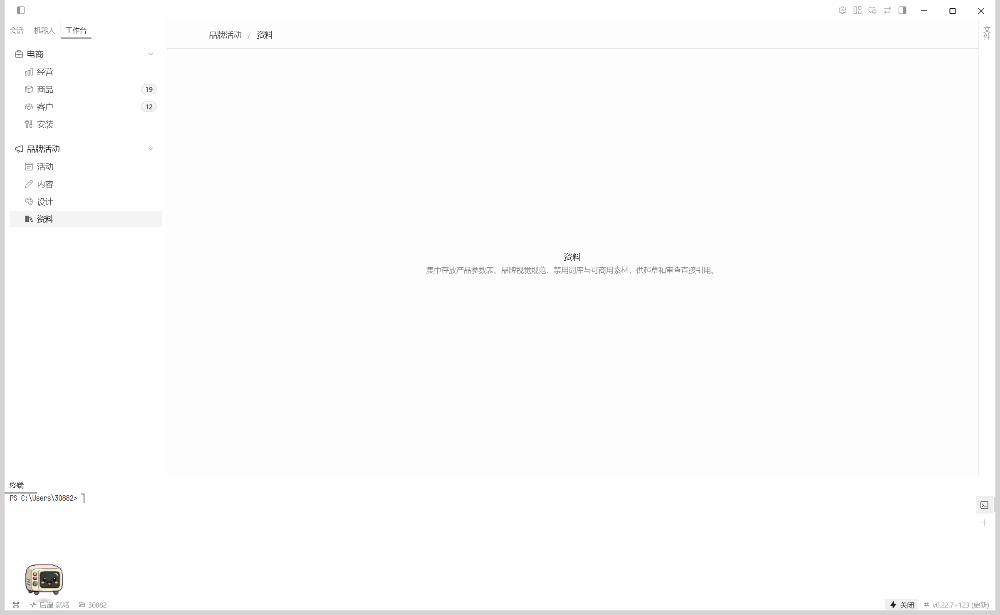
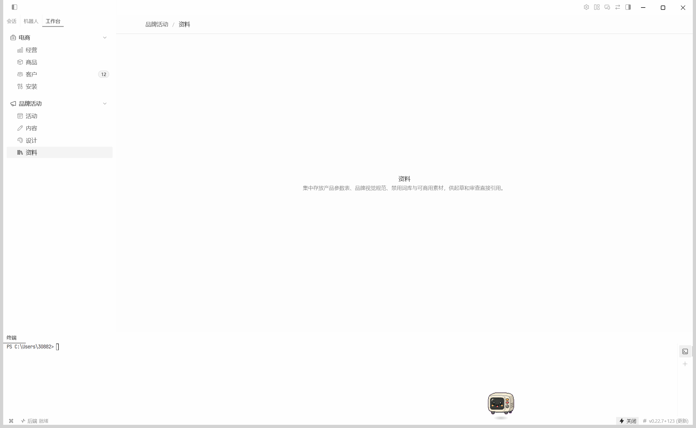

# W02 交付报告：工作台装进 Hermes 实测

实测环境：本机 Hermes `v0.22.7+123`，插件目录 `C:\Users\30882\.hermes\desktop-plugins\hermes-workbench\plugin.js`。分支 `main`。`server/` 与 `plugin/src/types.ts` 未改。

## 1. W01 审查的 6 项修正

这 6 项已在 `fa2a7ab` 落地。本次只改了第 5 项的路径形状，其余按代码与实测核对。

1. **Git 身份。** 仓库本地身份仍是 `Antigravity (Gemini) <antigravity@local>`。本次提交不改 git config，作者沿用近期提交的 `Cursor <cursor@local>`。
2. **离开工作台后清空高亮。** `syncLocationFromPath` 在 `parsePath` 失败时把 `location` 写成 `undefined`（`plugin/src/registry.ts`）。侧栏只在「工作台 / 会话」两个标签之间来回切时，路由仍停在工作台分页，高亮会留下，这和「路径已经不是工作台」不是同一件事。
3. **去掉 `/workbench/*`。** `plugin/src/plugin.tsx` 只为 8 个分页各注册一条精确路由，没有通配兜底。
4. **路由标题。** 每条路由的 `title` 是 `` `${wb.name} · ${page.label}` ``，例如 `电商 · 商品`、`品牌活动 · 资料`。页面打开后，会话标签条会让位；画面上能看到的是页内面包屑 `品牌活动 / 资料`，没有另出现一枚写着 `品牌活动 · 资料` 的标签。也没有把路径显示成英文。
5. **多段路径改成单段。** 见下一节。点击 8 个分页都能打开对应空状态（商品页已被并行改动换成真实页面）。
6. **代码在 `plugin/`。** 界面代码在 `plugin/`，`docs/` 在根目录。

## 2. 多段路径实测失败后的改法

改之前，`toPath` 生成 `/workbench/ecommerce/products`。点「商品」时主区域仍是新会话首页，并多出一个 `UNTITLED SESSION` 标签。Hermes 的 `RouteContribution` 注明 “One segment; no params”（`apps/desktop/src/app/routes.ts`）。三段路径对不上已注册路由时，`appViewForPath` 落到 `chat`。

现改为单段：

- `toPath`：`/wb-<workbench>-<page>`，例如 `/wb-ecommerce-products`、`/wb-brand-assets`
- `parsePath`：`/^\/wb-([^/?#]+)-([^/?#]+)\/?$/`

改完并重新打包、重启 Hermes 之后，8 个分页都能打开。最后停在「资料」：左栏该项高亮，页头是 `品牌活动 / 资料`，正文是资料页的空状态说明。

## 3. 打包

在 `plugin/` 执行 `npm run build:plugin`（Node v26.12.1）：

```
[build] 扫描到 638 个 Tailwind 类名候选
dist\hermes-workbench\plugin.js  91.4kb
Done in 26ms
```

产物 **93,582 字节**。这个体积包含工作区里尚未提交的商品页。`fa2a7ab` 当时的框架包是 31,677 字节（30.9 KB），那时样式扫描失败会退成空 CSS。

打包时曾经把 `react-dom` 的 `createPortal` 打进插件。Hermes 运行时只允许 `@hermes/plugin-sdk` 和 `react`，加载失败：

```
2026-11-05 21:21:14,722 [hermes] [renderer error:main] Plugin "hermes-workbench" failed to load: Error: unsupported import: react-dom — runtime plugins may only import @hermes/plugin-sdk and react
```

商品页的浮层和页头按钮已改为不再引用 `react-dom`（这些文件还在工作区，不属于本提交）。去掉之后重启 Hermes，`desktop.log` 里没有新的 `hermes-workbench` 加载失败记录。

## 4. 实测清单

| # | 项 | 结果 |
|---|---|---|
| 1 | 左上角「会话 \| 机器人 \| 工作台」，两个工作台、8 个分页 | **通过。** 电商下有经营、商品（徽标 19）、客户（徽标 12）、安装；品牌活动下有活动、内容、设计、资料。 |
| 2 | 每个分页打开，标题是中文而不是英文路径 | **通过（页内）。** 8 个分页都点过，没有再冒出新的 `UNTITLED SESSION`。「资料」页头为 `品牌活动 / 资料`。没有看到独立的 `品牌活动 · 资料` 标签，会话标签条在全页打开时会收起。 |
| 3 | Ctrl+R 后仍停在该分页 | **不能判通过。** 停在「资料」时按 Ctrl+R，无障碍树里同时出现 `NEW SESSION` 和「资料」。`desktop.log` 在 21:40:50 重新发布了 gateway。之后再点「工作台」，页面仍是「资料」。刷新瞬间更像回到了新会话，不能当作停留成功。 |
| 4 | 切到会话再切回，旧分页不再高亮，会话不被挡住 | **部分。** 只在「会话」「工作台」两个标签之间切换，路由没离开 `/wb-brand-assets`，回来后「资料」仍然高亮，页也还在。这不是「路径已经变成某条会话」的场景。切到「会话」标签时，树上出现了新会话占位文案。 |
| 5 | 窄窗口侧栏折叠后标签条和面板仍可用 | **未测。** |
| 6 | 浅色 / 深色跟随 | **只看了浅色。** 下面的截图都是浅色。深色没有切。 |
| 7 | 设置里关闭再打开插件 | **未测。** |
| 8 | 开发者工具里与工作台有关的日志 | **未打开 DevTools。** 主进程 `desktop.log` 里与本插件有关的原文只有上面那条 `react-dom` 加载失败（修复前）。21:36 重启之后到 21:40 没有新的 `hermes-workbench` 报错行。 |

## 5. 截图

浅色，工作台标签打开，右侧仍是一条会话：



浅色，「资料」分页（文件名沿用了抓取时的 `w02-products-light.png`，画面是资料页）：



从会话标签点回工作台之后，「资料」仍高亮：



和「会话」列表并排的对比图、深色、窄窗口这三张没有拍到。
