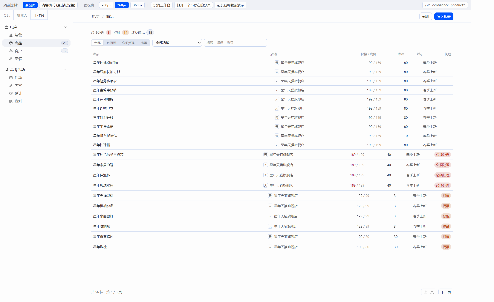
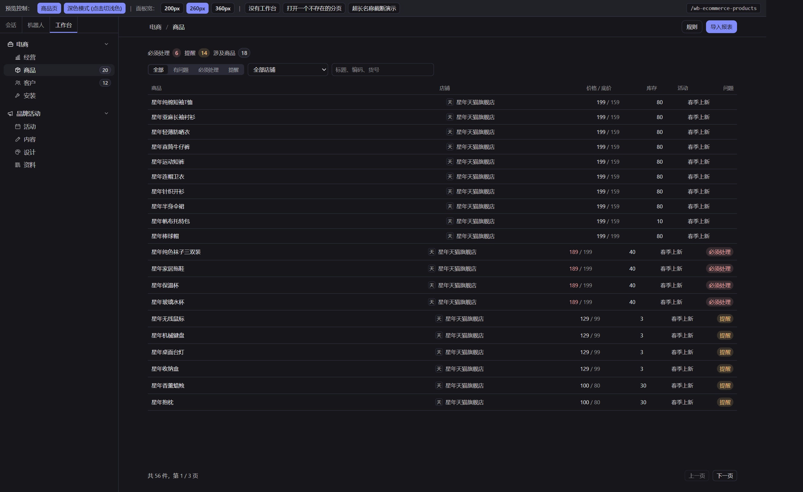
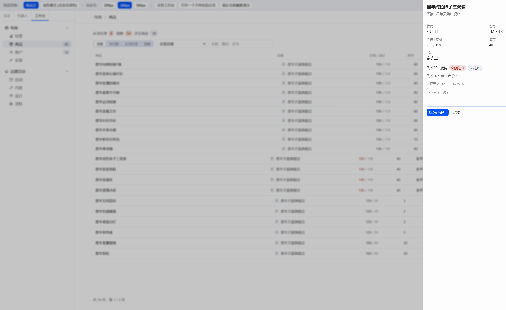
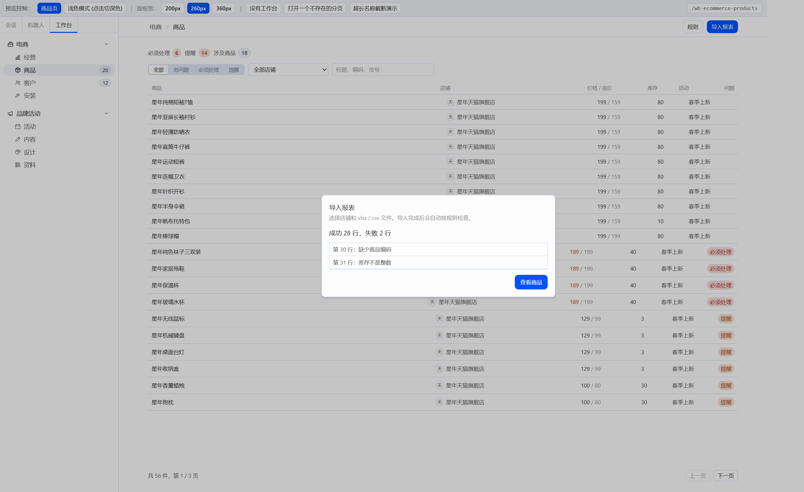
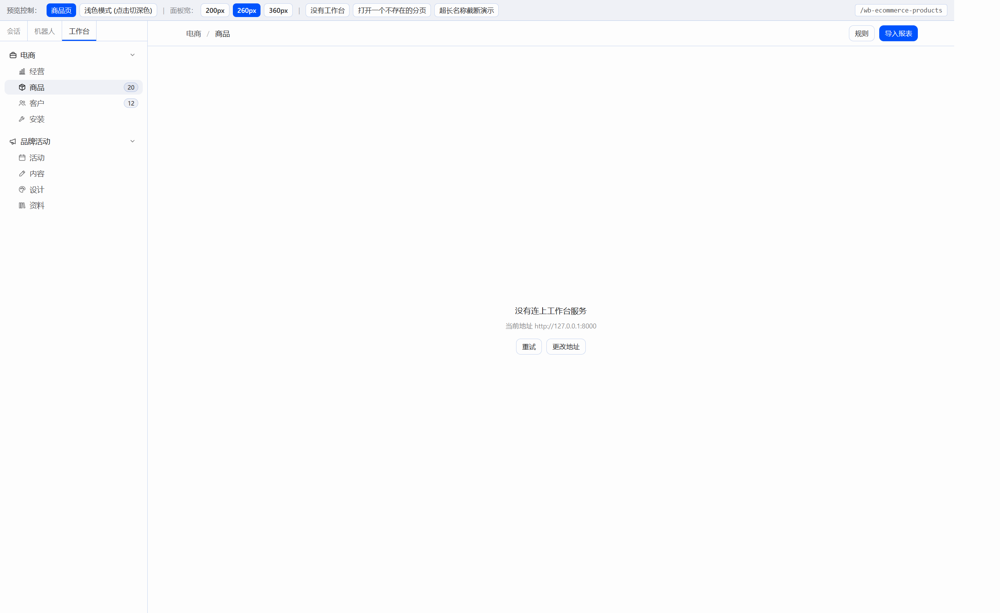

# W03 交付报告：商品页（接 C01 后端）

## 一、交付物与构建

只改了 `plugin/` 和本报告。`server/`、`docs/CONTRACT-products.md` 没有动。

| 文件 | 说明 |
|---|---|
| `plugin/src/api/client.ts` | 基础地址、`{error:{code,message}}`、超时；网络失败记为连不上 |
| `plugin/src/api/products.ts` | 店铺、商品、问题、规则、导入、汇总的类型和请求 |
| `plugin/src/api/useQuery.ts` | 加载中 / 出错 / 数据 / 重新加载，没有第三方请求库 |
| `plugin/src/api/open-count.ts` | 左栏徽标：读 `total_open`，60 秒刷新，失败时不显示数字 |
| `plugin/src/settings.ts` | 后端地址，`localStorage` 键 `hermes-workbench:api-base`，默认 `http://127.0.0.1:8000` |
| `plugin/src/pages/products/ProductsPage.tsx` | 汇总、筛选、列表、分页；页头按钮挂进 `data-slot="actions"` |
| `plugin/src/pages/products/IssueDrawer.tsx` | 右侧问题抽屉：标为已处理、忽略（ConfirmDialog）+ 备注 |
| `plugin/src/pages/products/ImportDialog.tsx` | 选店铺或新建、上传 xlsx/csv、成功/失败行 |
| `plugin/src/pages/products/RulesDrawer.tsx` | 四条规则的开关和参数，保存后立即检查 |
| `plugin/src/restore.ts` | 刷新前把工作台路径记入 `sessionStorage`，加载后再跳回去 |
| `plugin/src/modules/ecommerce.tsx` | “商品”分页渲染 `ProductsPage`，徽标改为开放问题数 |
| `plugin/src/plugin.tsx` | 只保留 `register`，补上插件简介 |
| `plugin/package.json` | `esbuild`、`@tailwindcss/node`、`@tailwindcss/oxide` 写进 devDependencies |
| `plugin/build.mjs` | 只用 `HERMES_SRC` 或 `F:\Hermes改造\hermes-agent`，找不到样式就退出 |
| `plugin/preview/` | “商品页”入口；补上这次用到的 SDK stub |

构建（在 `plugin/` 下，2026-11-05）：

- `npx tsc --noEmit` 通过。
- `npm run build`：tsc 通过，vite 6.4.5 打出 47 个模块。
- `node build.mjs`：读到 `F:\Hermes改造\hermes-agent\apps\desktop\src\styles.css`，扫描 641 个类名，写出 `plugin/dist/hermes-workbench/plugin.js`（93.8kb）。

页头按钮没有用 `react-dom` 的 `createPortal`。插件运行时的 import map（`apps/desktop/src/sdk/runtime.ts`）只提供 `react`、`react/jsx-runtime` 和 `@hermes/plugin-sdk`，没有 `react-dom`。按钮先渲染在页面里，`useLayoutEffect` 再把这一行挂到 `[data-slot="actions"]`，卸载前放回原处。

## 二、预览走查

后端 `http://127.0.0.1:8000`，样表是 `server/samples/` 里的天猫 xlsx 和京东 csv。两家店：星年天猫旗舰店、星年京东旗舰店。走查时开放问题 20 条（必须处理 6、提醒 14、涉及商品 18），左栏“商品”徽标 20。预览地址 `http://127.0.0.1:5173/`，没有打开 Hermes 窗口。

- 筛选“必须处理”得到 6 件商品；在这个筛选下搜“袜子”只剩 1 行。
- 全部商品共 56 件，第 2 / 3 页第一行是星年午睡毯。改筛选或搜索会回到第 1 页。
- 点“星年纯色袜子三双装”打开抽屉：售价低于底价，必须处理，未处理，原文“售价 189 低于底价 199”。
- “标为已处理”带备注后，状态变成已处理，汇总和左栏一起减少；“忽略”走确认框，状态变成已忽略。走查结束后把这条改回 `open`、备注清空，样例仍是 20 条开放问题。
- 规则抽屉把最低库存改成 12，保存后显示“已保存”，立即检查显示“新增 2 条，已处理 0 条”。改回 10 再检查，显示“新增 0 条，已处理 2 条”。临时多出来的两条已从库里删掉。
- 导入京东样表：成功 28 行，失败 2 行（第 30 行缺少商品编码，第 31 行库存不是整数）。“查看商品”关闭弹窗并刷新。
- 停掉后端后再请求，空状态标题是“没有连上工作台服务”，说明里是当前地址 `http://127.0.0.1:8000`，有“重试”和“更改地址”。更改地址打开输入框，保存后 `localStorage` 仍是这个地址。

截图时把预览根节点宽度收成 1680px，只为了让页头按钮落在截图窗口里。页面本身没有这道宽度限制。

## 三、截图

### 浅色列表

### 深色列表

### 问题抽屉

### 导入结果

### 连不上后端

## 四、借鉴

只借交互，没有拷代码，根目录 `THIRD_PARTY.md` 没有新增条目。

- Hermes 看板插件：页头操作、筛选、右侧抽屉。抽屉样式对齐 `apps/desktop/src/components/ui/sheet.tsx`（SDK 没有导出 Sheet）。
- Chatwoot：一条问题可以标为已处理或忽略，并带备注。
- Superset：表格的分页文案、空列表、加载占位。

## 五、后端接口缺口（只记录）

- `GET /api/products` 能按 `has_issue` 过滤，不能按问题级别过滤。`必须处理` / `提醒` 在前端做：先取该级别的开放问题，再把有问题的商品按每页 100 条拉全（最多 50 页），按商品 id 筛完再分页。
- `GET /api/issues` 没有 `product_id`。抽屉按店铺把问题取回，再留下当前商品的。
- `GET /api/issues/summary` 只有各店 `open_count` 和 `total_open`，没有必须处理 / 提醒 / 涉及商品。页头这三项用开放问题列表现算，并跟着店铺下拉走。左栏徽标用全局 `total_open`。
- 任务卡要求低于底价的价格用 `--ui-error`。Hermes `styles.css` 里没有这个变量。页面仍写了 `text-(--ui-error)`；预览的 `index.html` 补了浅色 `#b42318`、深色 `#f0a8a8`，否则截图里看不出红色。

## 六、WK01：刷新后回到工作台、插件简介

1. 刷新后回不到工作台页。原因在 Hermes `apps/desktop/src/app/contrib/surfaces.tsx` 第 217 行，`path="*"` 会立刻跳到新对话 `/`。外部插件加载得晚，刷新那一刻路由还没注册。
   - 停在工作台分页时，`pagehide` 和 `beforeunload` 把当前路径写入 `sessionStorage`，键 `hermes-workbench:restore`，值里带时间戳。
   - `register` 时读出并马上删除。30 秒内、路径对得上已注册的工作台分页、并且当前地址是新对话（hash 为空、`#` 或 `#/`）时，调用 `host.navigate`。
   - 不在工作台页时会清掉这个键，刷新对话不会被拉回来。
   - 把地址粘贴到一个新窗口打开，没有这份 `sessionStorage`，仍然回不来。这是 Hermes 的限制。
2. 默认导出加了 `description: '电商、品牌活动等部门工作台：左上角“工作台”标签和各业务页面。'`。`id`、`name` 没变。导出只留 `register`，去掉了 `setup`。
