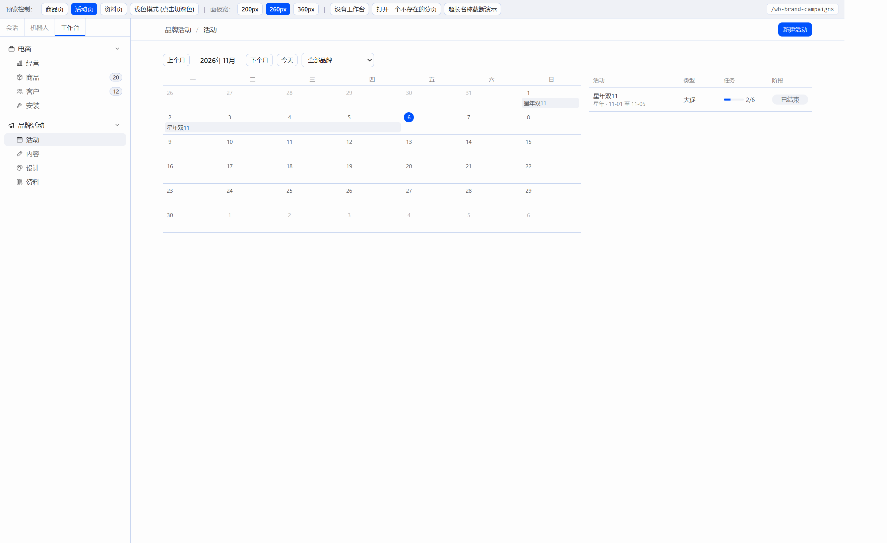
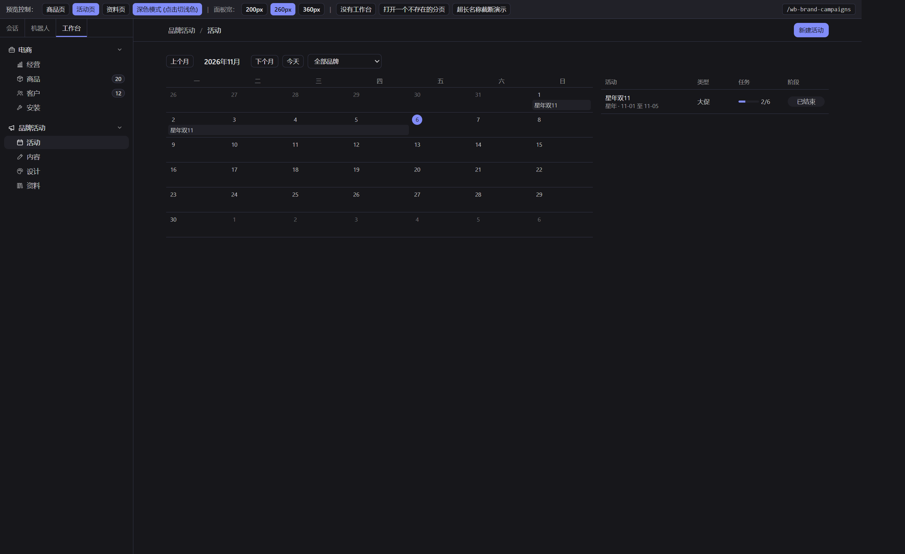
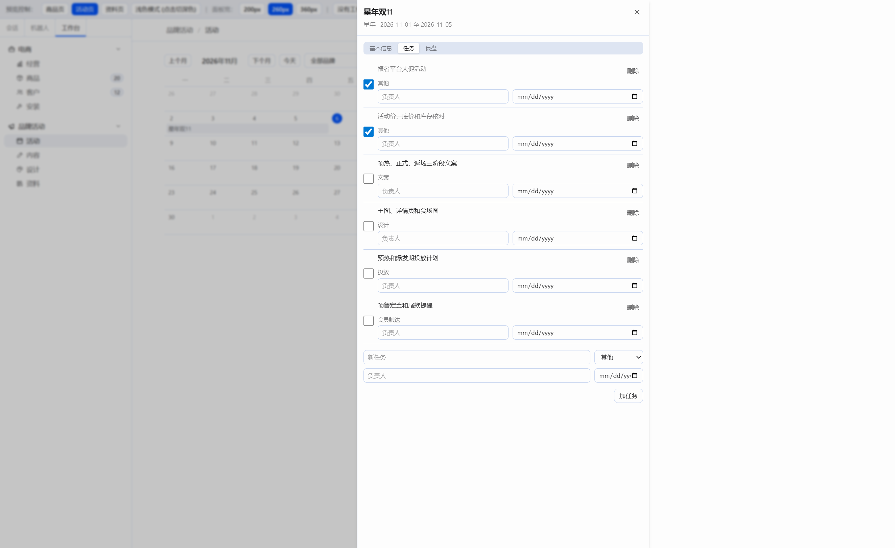
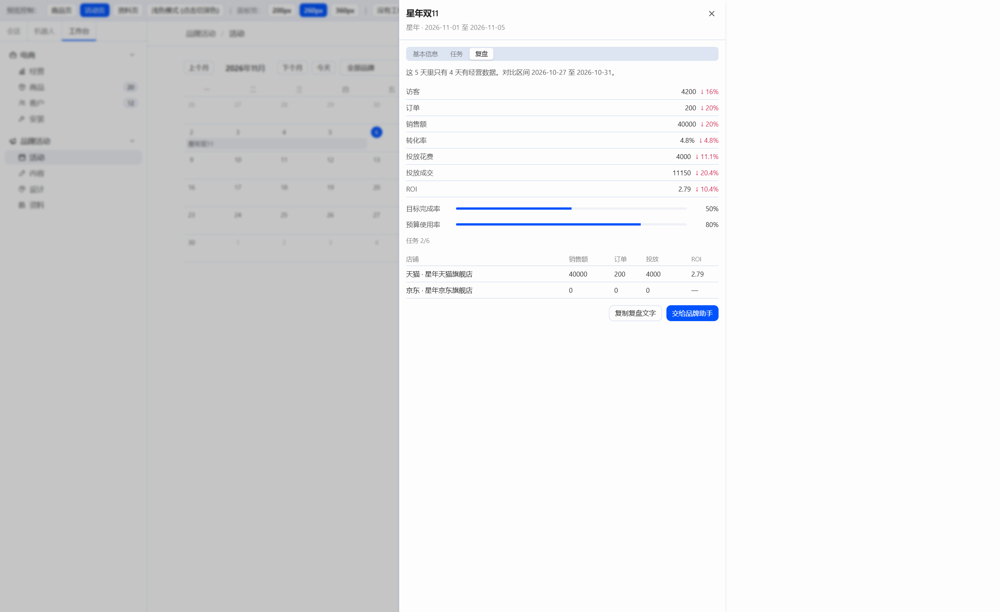
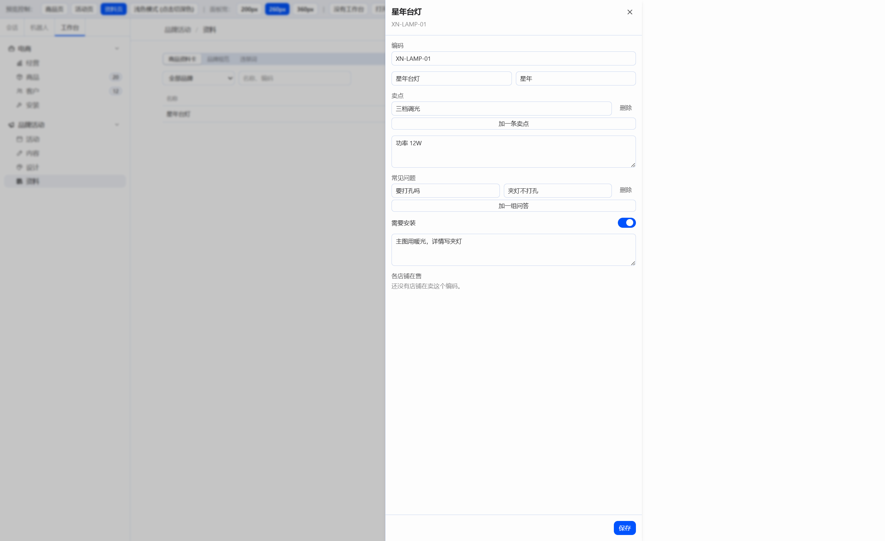
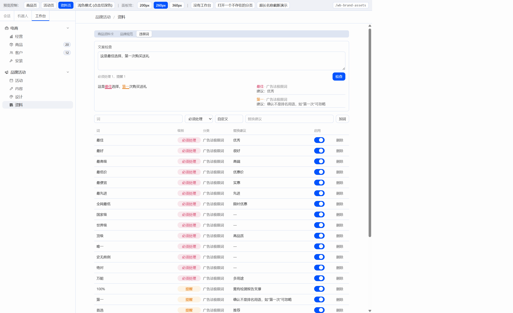
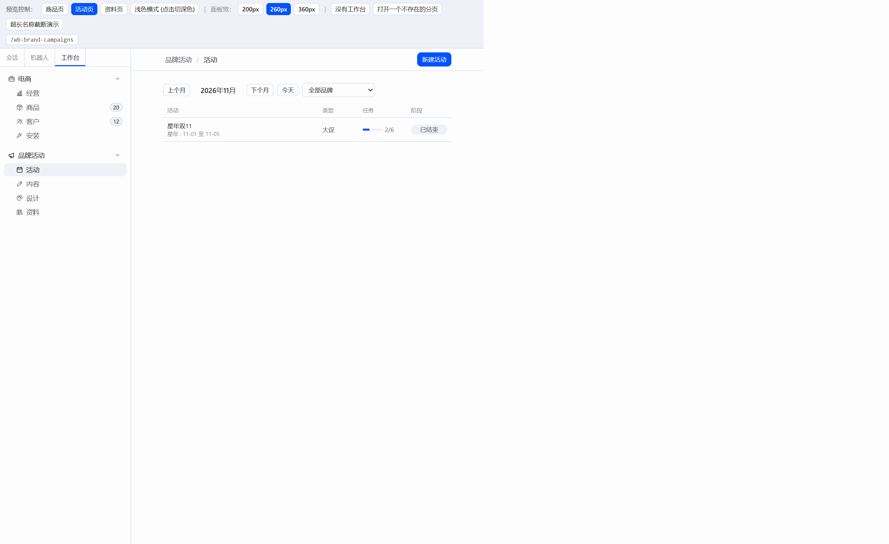

# W04 交付报告：活动页和资料页（接 C04 后端）

## 一、交付物与构建

只改了 `plugin/` 和本报告。`server/`、`docs/CONTRACT-*.md` 没有动。没有打开 Hermes 窗口。

| 文件 | 说明 |
|---|---|
| `plugin/src/api/brand.ts` | 品牌规范、违禁词、合规检查、资料卡、活动、任务、复盘 |
| `plugin/src/api/campaign-count.ts` | 左栏“活动”徽标：数 `phase=running`，60 秒刷新，失败不显示 |
| `plugin/src/pages/campaigns/CampaignsPage.tsx` | 月历 + 列表，窄窗口只留列表 |
| `plugin/src/pages/campaigns/CampaignDrawer.tsx` | 基本信息、任务、复盘 |
| `plugin/src/pages/campaigns/CampaignDialog.tsx` | 新建活动，默认套用任务清单 |
| `plugin/src/pages/campaigns/calendar.ts` | 周一起始的月格，同一周内色条按先到先占行 |
| `plugin/src/pages/assets/AssetsPage.tsx` | 商品资料卡 / 品牌规范 / 违禁词 |
| `plugin/src/pages/assets/CardDrawer.tsx` | 资料卡编辑 |
| `plugin/src/pages/assets/CompliancePanel.tsx` | 文案检查，下划线标出命中 |
| `plugin/src/pages/HeaderActions.tsx` | 页头按钮挂进 `data-slot="actions"`，活动和资料共用 |
| `plugin/src/pages/OfflineNotice.tsx` | “没有连上工作台服务”，商品页也改用这一份 |
| `plugin/src/modules/brand.tsx` | “活动”“资料”渲染新页面；内容和设计仍是空状态 |
| `plugin/preview/main.tsx` | 预览工具条加上“活动页”“资料页” |

W03 审查里要一起改的几项：

1. `text-(--ui-error)` 全部换成 `text-destructive`。预览 `index.html` 里补的 `--ui-error`、`--ui-warn` 已删。预览不加载 Hermes 的 `styles.css`，Tailwind 默认主题没有 `destructive`，所以 `preview.css` 的 `@theme` 写了 `--color-destructive: #cf2d56`（和 Hermes `--dt-destructive` 相同）。真插件构建仍引用 Hermes 样式，不靠这行。
2. 商品列表按级别改走 `GET /api/products?issue_level=must|warn`。问题抽屉改走 `GET /api/issues?product_id=`。顶部三项改走 `/api/issues/summary?shop_id=` 的 `must_open`、`warn_open`、`products_with_open`。左栏徽标仍用全局 `total_open`。
3. `plugin/src/registry.ts` 里乱码注释已改成“若尚未初始化位置，默认指向第一个注册的工作台首页”，文件按 UTF-8 保存。

构建（在 `plugin/` 下，2026-11-06）：

- `npm run build`：tsc 通过，vite 6.4.5 打出 59 个模块。
- `node build.mjs`：读到 `F:\Hermes改造\hermes-agent\apps\desktop\src\styles.css`，扫描 894 个类名，写出 `plugin/dist/hermes-workbench/plugin.js`（176.5kb）。

没有引入日历库或表单库。依赖仍是 `react` 和 `@hermes/plugin-sdk`。页头按钮继续不用 `react-dom`。

## 二、预览走查

后端 `http://127.0.0.1:8000`，预览 `http://127.0.0.1:5173/`。店铺仍是星年天猫旗舰店（id 1）和星年京东旗舰店（id 2）。给天猫店导入了 `server/samples/metrics-tmall.xlsx`（30 行成功，2 行失败：缺日期、访客不是整数）和 `ad-spend-tmall.xlsx`（120 行成功，2 行失败：缺日期、花费不是数字）。开放问题汇总仍是 `total_open` 20、`must_open` 6、`warn_open` 14。

活动：

- 新建“星年双11”，品牌星年，类型大促，2026-11-01 至 2026-11-05，目标销售额 80000，预算 5000，套用大促任务清单，生成 6 条任务。
- 月历切到 2026 年 10 月后这条不出现，点“今天”回到 11 月，色条跨在 1 日和 2–5 日两周。今天是 11 月 6 日，阶段是已结束；状态改成进行中并保存后，阶段仍按日期算，保持已结束。
- 勾了两条任务，进度变成 2/6。勾完停在任务分栏。
- 复盘：这 5 天里 4 天有经营数据，对比区间 2026-10-27 至 2026-10-31。访客 4200（↓16%）、订单 200（↓20%）、销售额 40000（↓20%）、转化率 4.8%（↓4.8%）、投放花费 4000（↓11.1%）、投放成交 11150（↓20.4%）、ROI 2.79（↓10.4%）。目标完成率 50%，预算使用率 80%。天猫店有数，京东店是 0（只导入了天猫样表）。
- 左栏“活动”没有数字：没有 `phase=running` 的活动，徽标隐藏。

资料：

- 新建资料卡 XN-LAMP-01 / 星年台灯，卖点、参数、一组问答、需安装、备注都保存了。再打开时编码不可改，备注改成“主图用暖光，详情写夹灯”后能保存。这个编码没有对应在售商品，抽屉写“还没有店铺在卖这个编码”。
- 品牌规范给“星年”保存了语气、色值 `#1f4b3a`、字体、Logo 用法和其他注意，页面显示“已保存”。
- 违禁词加了“测试词”（必须处理，建议“换成具体说法”），确认后删除，种子词还在。
- 检查“这是最佳选择，第一次购买送礼”：必须处理 1（最佳，红色下划线），提醒 1（第一，琥珀色下划线）。

复制复盘和“交给品牌助手”在这个预览浏览器里被拒绝了剪贴板写入，按钮提示“复制失败，请手动选择文字”。代码里加了选中后再复制的退路，这次环境里同样被拒绝。

截图时把预览根收窄，只为了让页头按钮和右侧抽屉落在截图窗口里。页面本身没有这道宽度限制。窄窗口那张把内容区收到 760px 以下，月历格子隐藏，只留列表。

## 三、截图

浅色月历：

深色月历：

活动抽屉，任务：

活动抽屉，复盘：

资料卡抽屉：

违禁词检查：

窄窗口，只留列表：

## 四、借鉴

- FullCalendar 月视图：同一周里多条活动按开始列、再按跨度，用先到先占的行号排开，避免重叠。算法写在 `calendar.ts`，没有拷它的代码，也没有加 `THIRD_PARTY.md`。
- Plane：只看了周期和进度的摆法。目标完成率、预算使用率是一行细进度条，没有搬它的组件。
- Chatwoot：只看了设置页里小表格的增删。违禁词、卖点、问答、品牌色都是一行一条，删除前用 ConfirmDialog。
- Hermes 看板插件的抽屉和任务勾选、设置页的表单行：活动抽屉和资料卡抽屉沿用商品页那只 `SideDrawer`，任务勾选即时保存。

## 五、后端接口（只记录）

- 活动列表没有 `phase` 查询。进行中徽标只能拉全部活动，在前端数 `phase=running`。
- 活动 PATCH 没有 `brand`。抽屉里品牌只读。
- 商品行上的“必须处理 / 提醒”仍要再请求 `GET /api/issues?status=open`。`ProductOut` 只有 `open_issue_count`，没有级别。顶部汇总已经改用 summary。
- 合规检查按子串匹配。“第一”会命中“第一次”，区间是服务端给的。界面按返回位置画下划线，建议里写了“第一次”可忽略。
