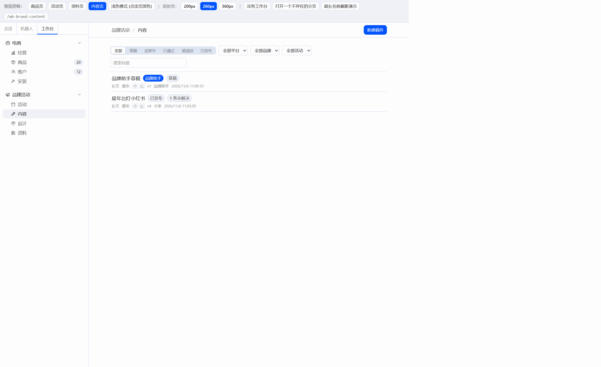
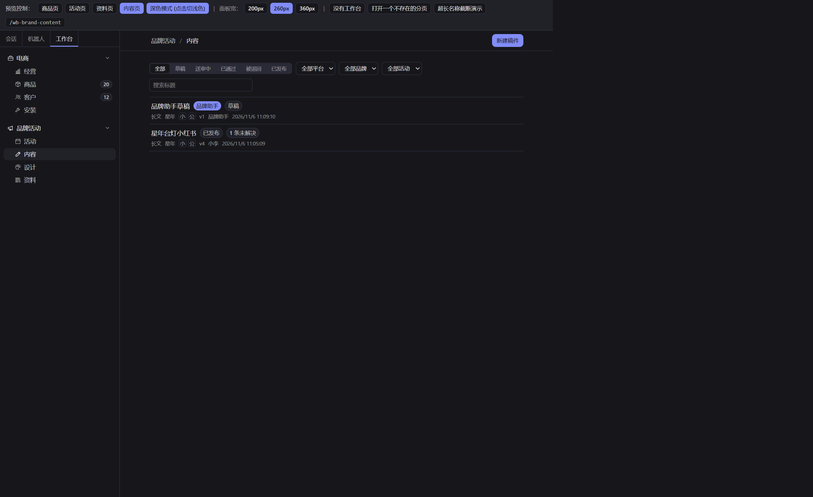
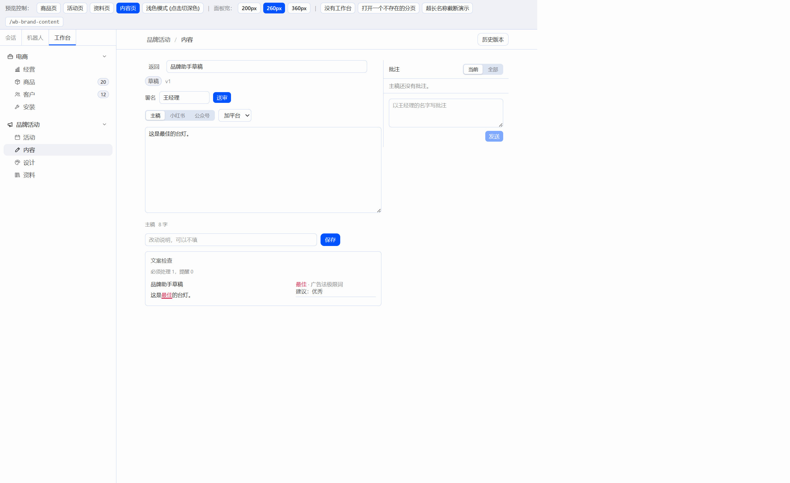
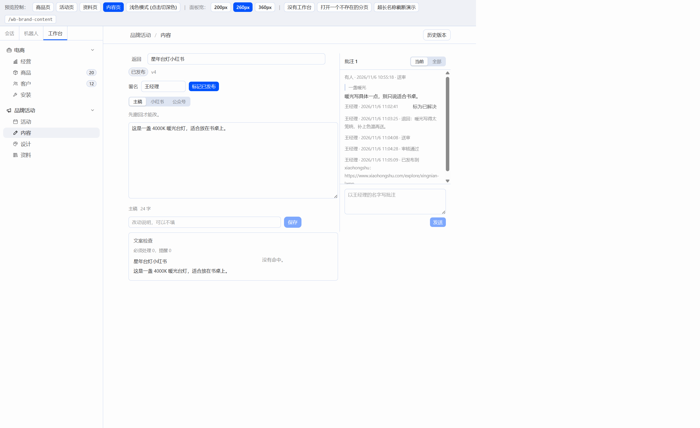
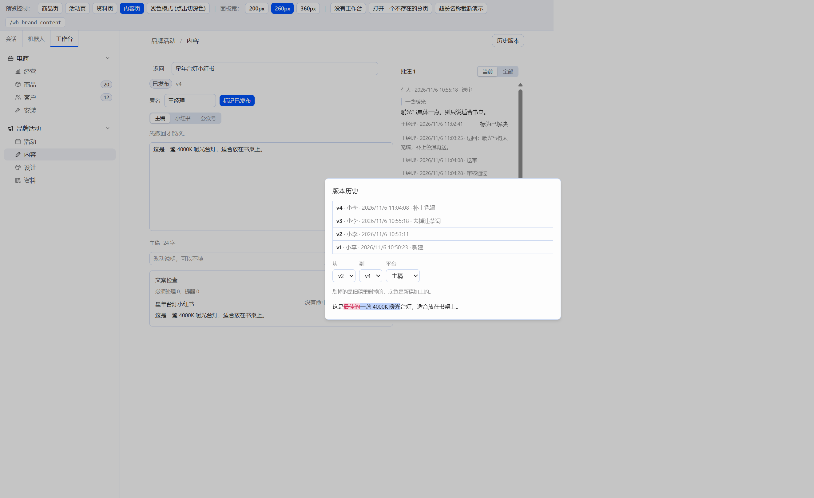
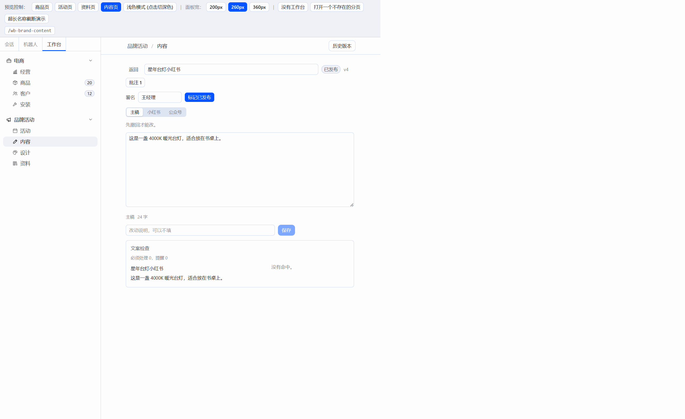

# W05 交付报告：内容页（接 C05 后端）

## 一、交付物与构建

只改了 `plugin/` 和本报告。`server/`、`docs/CONTRACT-*.md` 没有动。没有打开 Hermes 窗口。

| 文件 | 说明 |
|---|---|
| `plugin/src/api/contents.ts` | 稿件、版本、批注、流转、对比 |
| `plugin/src/api/content-count.ts` | 左栏“内容”徽标：数 `status=in_review`，60 秒刷新，失败不显示 |
| `plugin/src/pages/contents/ContentsPage.tsx` | 列表和新建稿件 |
| `plugin/src/pages/contents/ContentEditor.tsx` | 整页编辑，主稿和平台版本 |
| `plugin/src/pages/contents/CommentsPanel.tsx` | 右侧批注栏，可拖宽 |
| `plugin/src/pages/contents/VersionsDialog.tsx` | 版本列表和行内对比 |
| `plugin/src/pages/contents/labels.ts` | 平台、类型、状态的中文 |
| `plugin/src/pages/assets/CompliancePanel.tsx` | 加上可选的 `text` 和 `auto`，编辑页停输 600ms 后检查当前文字 |
| `plugin/src/pages/products/ImportDialog.tsx` | 顶部报表文件夹一行 |
| `plugin/src/api/products.ts` | `GET /api/import/folder`、`POST /api/import/folder/scan` |
| `plugin/src/modules/brand.tsx` | “内容”渲染 `ContentsPage`，徽标接送审数 |
| `plugin/src/pages/HeaderActions.tsx` | 卸载时把页头按钮挂回原父节点 |
| `plugin/preview/main.tsx` | 预览工具条加上“内容页” |

SDK 里没有 Tabs，主稿和各平台用 SegmentedControl 切换。Hermes 的 `styles.css` 只有 `--color-destructive`，没有成功色。对比里删掉的字用 `bg-destructive/15 text-destructive line-through`，加上的字用 `color-mix(in srgb, var(--ui-accent) 24%, transparent)`。没有引入编辑器、diff 或表单库。依赖仍是 `react` 和 `@hermes/plugin-sdk`。

构建（在 `plugin/` 下，2026-11-06）：

- `npm run build`：tsc 通过，vite 6.4.5 打出 66 个模块。
- `node build.mjs`：读到 `F:\Hermes改造\hermes-agent\apps\desktop\src\styles.css`，扫描 1077 个类名，写出 `plugin/dist/hermes-workbench/plugin.js`（238.7kb）。

## 二、预览走查

后端 `http://127.0.0.1:8000`（真实库 `workbench.db`），预览 `http://127.0.0.1:5173/`。品牌星年，活动“星年双11”。

稿件“星年台灯小红书”，作者小李，类型长文，平台小红书和公众号：

- 正文写成“这是最佳的台灯，适合放在书桌上。”文案检查显示必须处理 1，“最佳”红色下划线，建议“优秀”。
- 送审被拦，流转按钮旁显示“有必须修改的违禁词：最佳”。
- 改成“这是一盏暖光台灯，适合放在书桌上。”后送审。署名当时是空的，这条审核记录作者显示“有人”。
- 选中“一盏暖光”，以王经理的名字写下“暖光写具体一点，别只说适合书桌。”引用和起止位置都带上了。送审中的稿件正文只读，批注按钮仍然出现。
- 王经理退回，原因“暖光写得太笼统，补上色温再送。”退回原因留空时对话框不关，并提示“退回时请写明原因”。
- 改成“这是一盏 4000K 暖光台灯，适合放在书桌上。”改动说明“补上色温”，再送审，通过。
- 标记小红书已发布，链接 `https://www.xiaohongshu.com/explore/xingnian-lamp`。审核记录写着“已发布到 xiaohongshu：”加上这个链接。
- 送审期间左栏“内容”显示 1。退回、通过、发布之后数字消失。0 和请求失败都不显示徽标。
- 小红书分栏显示“字数 / 1000，超出只是提醒”，不拦截保存。已发布和已通过的正文只读，旁边写“先撤回才能改”。
- 历史版本四条：v1 新建（正文是空的）、v2 含“最佳的”、v3 说明“去掉违禁词”、v4 说明“补上色温”。v1 对 v4 整段都是新增。v2 对 v4 能看出删和加：“最佳的”划掉，“一盏 4000K 暖光”加底色。

另建草稿“品牌助手草稿”，作者品牌助手。列表这一行有“品牌助手”Badge，状态是草稿。编辑时写过一句含“最佳”的正文，没有保存，点返回弹出“还有没保存的修改”，确认离开后列表里的正文仍是空的。

窄窗口：编辑区宽度低于 760px 时，右侧批注栏收成“批注 1”。点开是盖在正文上的批注层，可以关掉。

报表文件夹：当前这个后端进程的 `GET /api/import/folder` 返回 `enabled: false`。导入报表对话框顶部显示“还没启用自动导入。把 server\scripts\env.example.bat 复制成 env.bat，填上 WB_IMPORT_DIR（每个店铺一个同名子文件夹），保存后重启后端。”启用后的路径和“立即导入”写在同一行里，这次没有设置 `WB_IMPORT_DIR`，没有点到。

走查里发现并改掉的一处：从编辑页返回时，页头按钮要插回一个已经被换掉的兄弟节点，浏览器抛 `NotFoundError`，整页被卸掉。`HeaderActions` 改为挂回原父节点。改完后返回能回到列表。

截图时把预览根收窄，只为了让编辑区和批注栏落在截图窗口里。页面本身没有这道宽度限制。

## 三、截图

浅色列表：

深色列表：

编辑页，合规下划线：

批注栏：

版本对比（v2 对 v4）：

窄窗口，批注收成按钮：

## 四、借鉴

- react-diff-viewer-continued：只借行内高亮的配色。删除是破坏色底加删除线，新增是强调色的浅底。对比写在 `VersionsDialog.tsx`，没有拷它的代码，也没有加 `THIRD_PARTY.md`。
- Docmost：只看了选中文字后出现批注、侧栏里带引用原文。批注栏是自己写的，可拖宽，窄窗口收成按钮。
- Plane：只看了状态按钮排成一行。送审、撤回、通过、退回、标记已发布按当前状态显示。
- Hermes 对话输入：保存走按钮，也走 Ctrl/Cmd+S。正文是多行文本框，没有富文本工具栏。看板插件的流转按钮：退回要填原因，用 ConfirmDialog。

## 五、后端接口（只记录）

- 送审数量没有单独的计数接口。徽标拉 `GET /api/contents?status=in_review`，用列表长度。稿件少的时候这样够用。
- 审核记录的正文由后端生成。发布一条是“已发布到 xiaohongshu：链接”，平台用的是代码。界面原样显示。
- 这次进程没有启用报表文件夹，`enabled` 为 false。启用后按文件列出成功、失败和原因的那一段没有在这个进程上跑过。
