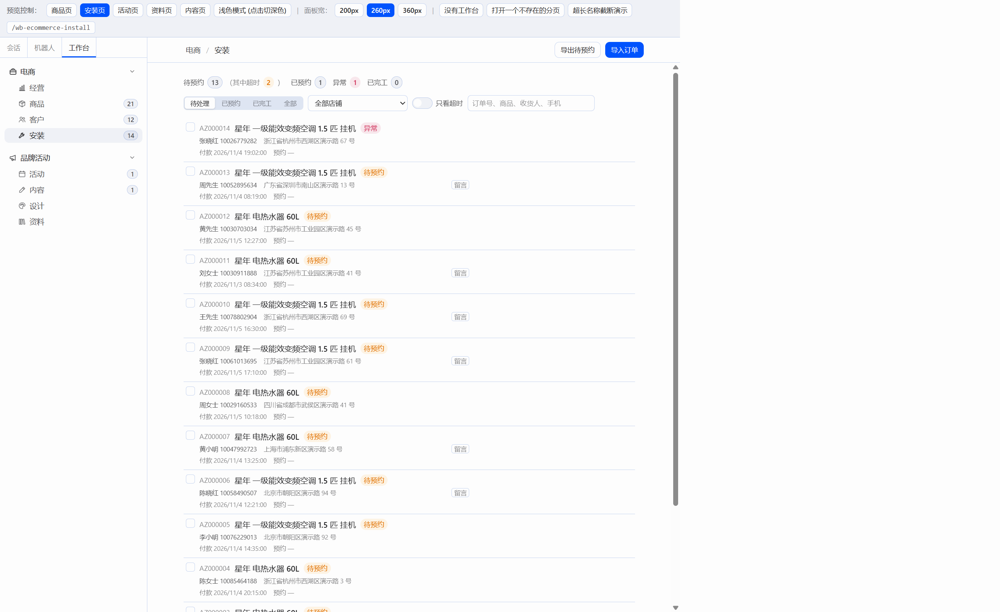
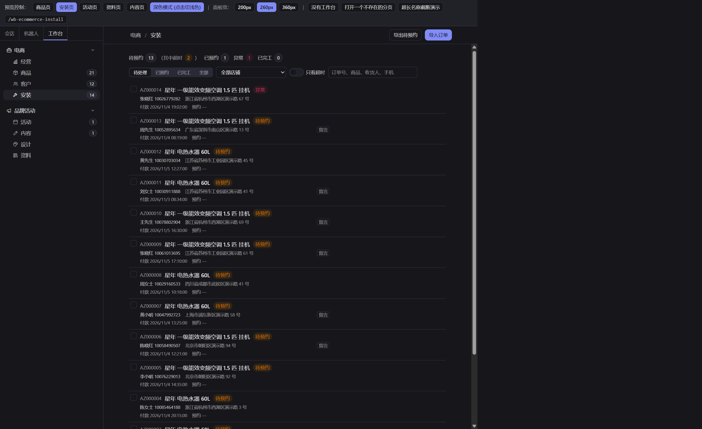
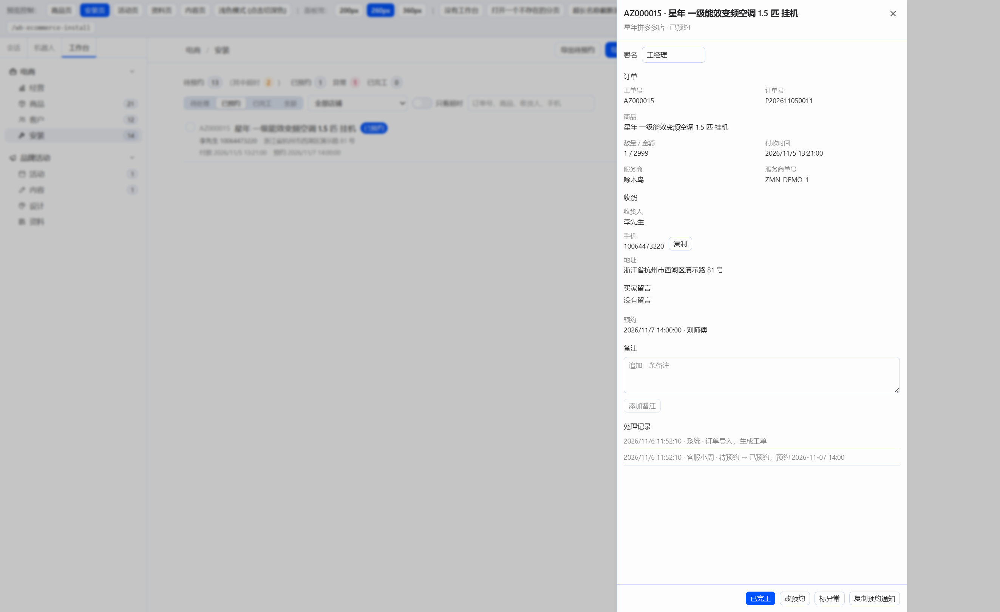
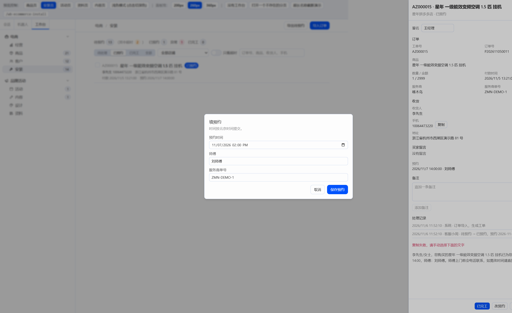
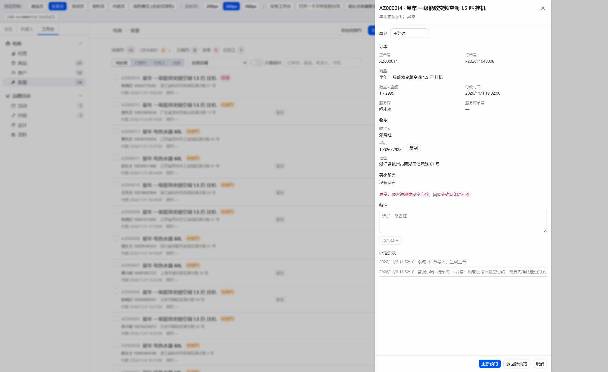
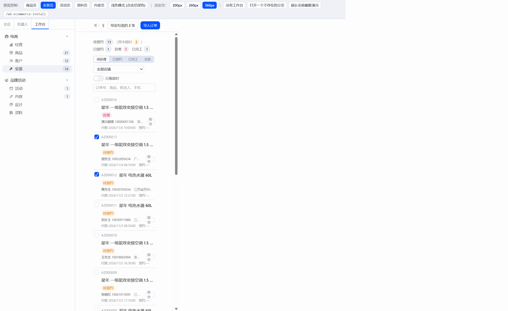

# W06 交付报告：安装页（接 C07 后端）

## 一、交付物与构建

只改了 `plugin/` 和本报告。`server/`、`docs/CONTRACT-*.md` 没有动。没有打开 Hermes 窗口。

| 文件 | 说明 |
|---|---|
| `plugin/src/api/installs.ts` | 工单列表、详情、汇总、流转、备注、预约通知、导出 |
| `plugin/src/api/install-count.ts` | 左栏“安装”徽标：`needs_action`，60 秒刷新，失败不显示 |
| `plugin/src/pages/installs/InstallsPage.tsx` | 汇总、筛选、多选列表、导入导出 |
| `plugin/src/pages/installs/InstallDrawer.tsx` | 工单抽屉 |
| `plugin/src/pages/installs/BookDialog.tsx` | 填预约、标异常 |
| `plugin/src/pages/installs/labels.ts` | 状态中文、北京时间、提交用的 `+08:00` |
| `plugin/src/pages/products/ImportDialog.tsx` | 增加“订单”类型，结果带“新建工单 N 张” |
| `plugin/src/modules/ecommerce.tsx` | “安装”渲染 `InstallsPage`，徽标接 `needs_action` |
| `plugin/src/restore.ts` | 刷新后在插件侧把工作台地址拉回来 |
| `plugin/src/pages/HeaderActions.tsx` | 页头按钮只移动内层节点，避免断开时整页卸掉 |
| `plugin/src/pages/products/IssueDrawer.tsx` | 已处理、已忽略的问题可以重新打开 |
| `plugin/preview/main.tsx` | 预览工具条加上“安装页” |

预约时间用浏览器自带的 `datetime-local`，样式用 Hermes 的 Input。没有加日期选择器或其他库。依赖仍是 `react` 和 `@hermes/plugin-sdk`。SDK 里已有 Switch 和 Checkbox。预览桩补了 Checkbox，并且不再把 Switch 的 `size` 传到 DOM 上。

构建（在 `plugin/` 下，2026-11-06）：

- `npm run build`：tsc 通过，vite 6.4.5 打出 72 个模块。
- `node build.mjs`：读到 `F:\Hermes改造\hermes-agent\apps\desktop\src\styles.css`，扫描 1160 个类名，写出 `plugin/dist/hermes-workbench/plugin.js`（277.8kb）。

## 二、预览走查

真实库仍在 `http://127.0.0.1:8000`。演示库 `server/data/demo.db` 另开在 `http://127.0.0.1:8001`，预览指向这一端口。`:8000` 上的进程没有动。仓库里没有 `docs/reports/WK03/` 截图，窄窗口按 360px 内容宽自查。

演示库一开始 15 张工单。生成时 `created_at` 都是当时，超时是 0。把 AZ000001、AZ000002 的创建时间改到 48 小时以前之后，汇总是待预约 13、已预约 1、已完工 0、异常 1、超时 2，`needs_action` 14。左栏“安装”显示 14。

走查：

- 待处理只留下待预约和异常。已预约只留下已预约。搜索“演示顾客”只留下这一张。只看超时只留下 AZ000001、AZ000002。
- 打开已预约的 AZ000015：师傅刘师傅，服务商单号 ZMN-DEMO-1，预约 2026-11-07 14:00。复制预约通知时剪贴板被预览环境拦住，页面给出通知全文，并写“复制失败，请手动选择下面的文字”。追加备注“顾客确认周六上午可以上门”，然后标已完工。
- 空的预约时间点保存，对话框不关，提示“请填写预约时间”。异常单 AZ000014 重新预约到 2026-11-09 09:00、师傅赵师傅。接口存成 `2026-11-09T01:00:00+00:00`，也就是北京时间 09:00。
- 空的异常原因点保存，对话框不关，提示“请填写异常原因”。导入一张订单表（货号 XN-AC35，手机 10000001106，地址是演示路），结果“新建工单 1 张”，列表出现 AZ000016。再把它标成异常，原因“顾客临时出差，下周再约”。
- 勾选两张后按钮变成“导出勾选的 2 张”。导出请求体是 `{"ids":[13,12]}`，返回的 CSV 只有这两张，表头是工单号、店铺、订单号等。
- 把地址改成一个没有服务的端口，安装页换成断开提示，上面有“重试”和“更改地址”。更改地址打开的是插件自己的地址输入框（存在 `localStorage` 的 `hermes-workbench:api-base`），没有宿主设置页。改回 `http://127.0.0.1:8001` 并保存后，列表回来了，页面没有被卸掉。请求失败时左栏数字徽标消失。
- 360px 内容宽下，安装页的筛选换行，工单行往下排，页面本身没有横向溢出。商品表放在 `overflow-x-auto` 里，窄的时候表在格子里横滑，不把整页撑出去。

内容页的审核记录按接口原文显示，没有再把“已发布到小红书”翻一次。

这次演示进程的报表文件夹仍是关的。导入订单对话框里写着还没启用自动导入。

## 三、先修

刷新丢页面：Hermes 桌面端的路由表有一条 `path="*"`，会把不认识的地址换成 `#/`。外部插件的路由注册得晚，Ctrl+R 时浏览器还留着 `#/wb-ecommerce-products`，这条兜底先把它改成 `#/`。旧的恢复逻辑在路由注册之前就 `navigate`，又被兜底弹回 `#/`，而且当时只要地址还不是 `#/` 就把 sessionStorage 的记录删掉了。现在改成路由注册之后再恢复，记录保留 1 分钟。启动后 2 秒内如果地址是 `#/` 且记录还新，就跳回工作台，并在 0、50、300、1000 毫秒和 hash 变化时再试，因为宿主可能在插件第一次检查之后才写成 `#/`。人真正打开一个普通会话、或过了这 2 秒再停在 `#/`，记录会清掉，不会把人从聊天里拉回来。新开的窗口没有这份 sessionStorage，贴地址进去仍然回不去。

宿主把工作台路由 id 当成会话 id 去查，因此刷新时会有一批 404。这是宿主的行为，插件没有改。

页头按钮：W05 修的是卸载时 `insertBefore` 对着已经不在的兄弟节点。断开提示换上来时，React 仍会拿被挪走的宿主节点当插入锚点，同一类错误还在。现在 React 树里留一个空的 `span`，只把里面的按钮层挪进页头。卸掉时如果这个 `span` 还在文档里，就把按钮层放回去，否则直接移除。上面的断开、改地址、再连上，页面没有被卸掉。

问题抽屉：状态不是 open 时显示“重新打开”，`PATCH /api/issues/{id}`，body 是 `{status: "open"}`。这次演示库里的问题都是 open，按钮没有出现在屏幕上。

## 四、截图

浅色列表（待处理，超时 2）：

深色列表：

已预约抽屉：

填预约：

异常单：

窄窗口（内容宽 360px）：

抽屉截图时把浮层往左挪了一截，只为了落进截图窗口。页面上它仍贴在右侧。

## 五、借鉴

- Hermes 看板插件：只看了右侧抽屉和列表多选。工单抽屉是 `SideDrawer`，勾选在行按钮外面，导出按勾选的 id。
- Chatwoot：只看了联系人一块加复制、下面接活动记录。收货人、手机旁的“复制”、处理记录用的是这个排布。处理记录是扁平行，没有竖线时间轴。
- oms-erp：只看了订单详情里收货和状态分成几组。抽屉里订单、收货、买家留言、备注、处理记录分开。

没有拷这些项目的代码，也没有加 `THIRD_PARTY.md`。

## 六、后端接口（只记录）

- `GET /api/installs/summary` 的 `done` 是全部已完工，没有“今天已完工”。汇总上写的是“已完工”，没有造一个今天的数字。
- 列表没有多状态、也没有分页。“待处理”不传 `status`，拿到结果后再留下 pending 和 exception。
- 已预约工单再点“改预约”并保存，接口返回 409，文案是“工单已经是已预约”。同一状态不算一次流转，预约时间只在改成 booked 时写入。待预约填预约、异常单重新预约都可以。已预约要改时间，需要接口允许停在 booked 上更新 `appointment_at`。
- 预览页和 API 不同源，读不到 `Content-Disposition`，下载文件名退回 `install.csv`。响应头里实际有 `filename*=UTF-8''install-{时间}.csv`。同源时会用这个名字。
- 演示数据刚生成时没有超时单。超时看的是 pending 且 `created_at` 超过 48 小时。
