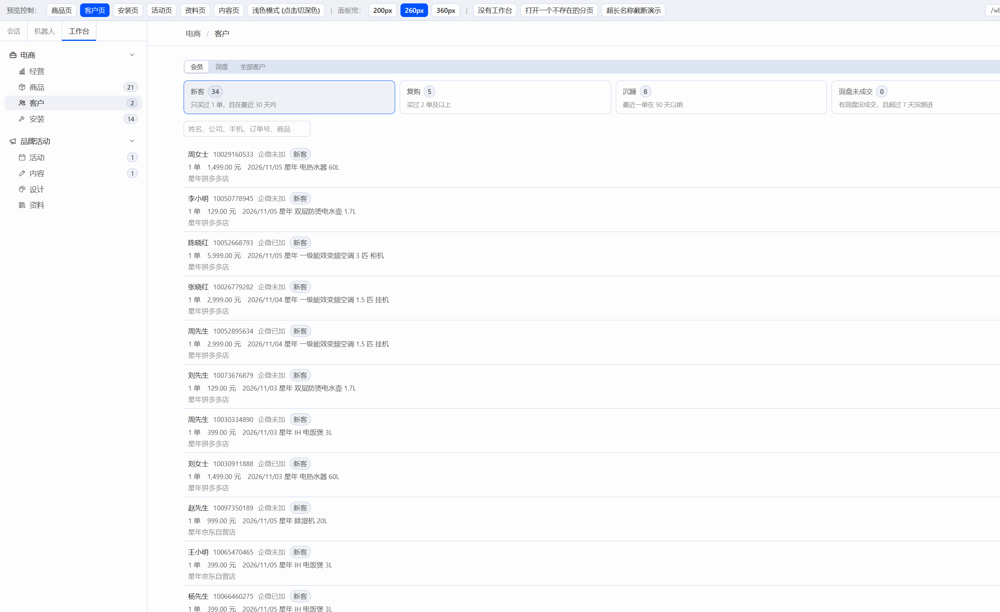
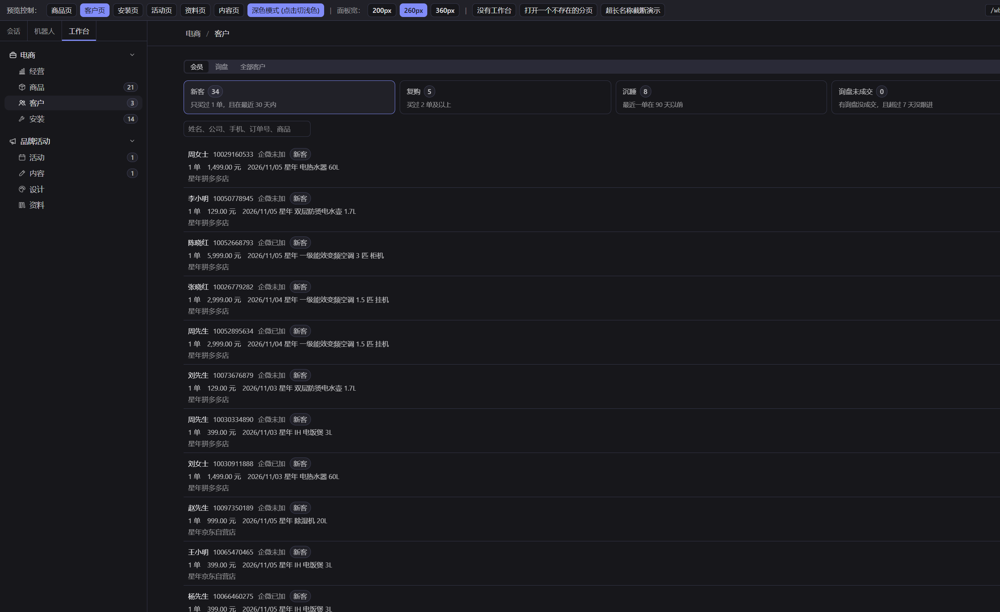
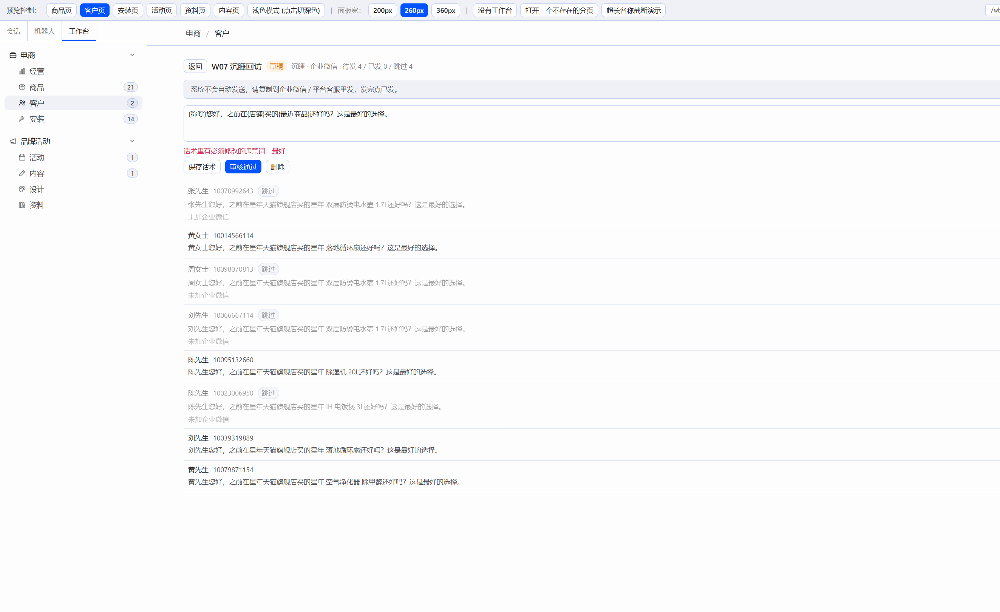
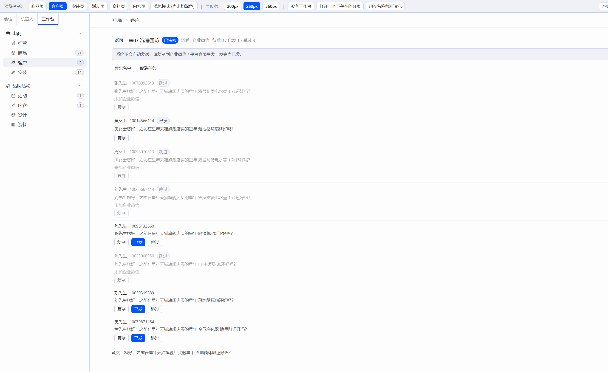
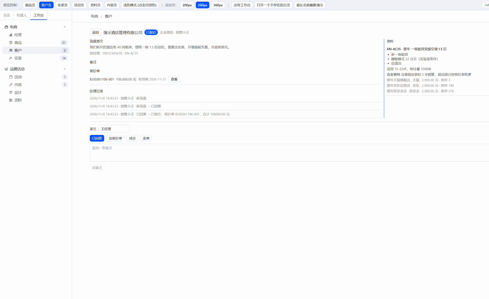
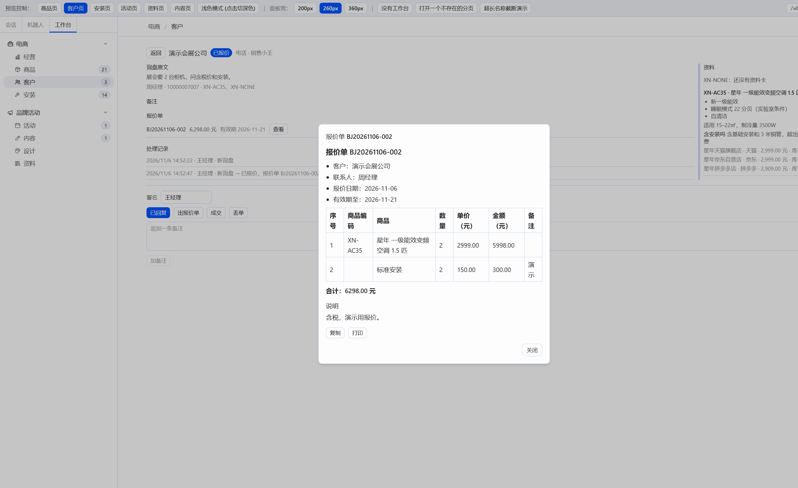
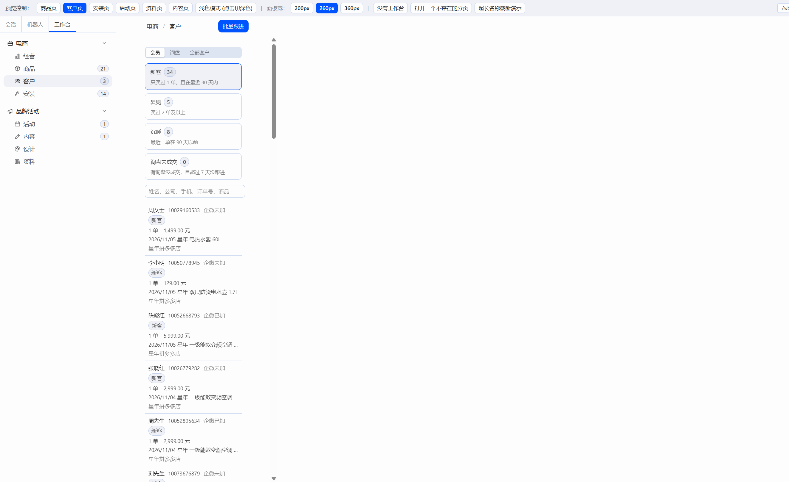

# W07 交付报告：客户页（接 C08 后端）

## 一、交付物与构建

只改了 `plugin/` 和本报告。`server/`、`docs/CONTRACT-*.md` 没有动。没有打开 Hermes 窗口。

| 文件 | 说明 |
|---|---|
| `plugin/src/api/customers.ts` | 客户、询盘、报价、跟进的请求 |
| `plugin/src/api/inquiry-count.ts` | 左栏“客户”徽标：`open_inquiries`，60 秒刷新，失败不显示 |
| `plugin/src/pages/customers/CustomersPage.tsx` | 会员 / 询盘 / 全部客户 |
| `plugin/src/pages/customers/CustomerDrawer.tsx` | 客户抽屉 |
| `plugin/src/pages/customers/InquiryView.tsx` | 询盘详情，右侧资料栏可拖宽 |
| `plugin/src/pages/customers/QuoteDialog.tsx` | 出报价单，正文用 SDK 的 `Streamdown` |
| `plugin/src/pages/customers/FollowupView.tsx` | 跟进任务 |
| `plugin/src/pages/installs/InstallsPage.tsx` | 汇总改为“今日完工”，读 `done_today` |

预约时间仍是浏览器自带的日期时间框。没有加富文本、表格或 PDF 库。报价单打印用 `window.print()`，只露出报价单那一块。依赖仍是 `react` 和 `@hermes/plugin-sdk`。

构建（在 `plugin/` 下，2026-11-06）：

- `npm run build`：tsc 通过，vite 6.4.5 打出 80 个模块。
- `node build.mjs`：读到 `F:\Hermes改造\hermes-agent\apps\desktop\src\styles.css`，扫描 1349 个类名，写出 `plugin/dist/hermes-workbench/plugin.js`（369.1kb）。

## 二、先修

安装页汇总现在写“今日完工”，数字是 `done_today`。演示库刚生成时是 0。

已预约的 AZ000015 打开“改预约”，时间从 2026-11-07 14:00 改到 2026-11-08 10:00。请求仍是 `status: booked` 加新的 `appointment_at`。没有 409。处理记录多了一条“改预约：2026-11-07 14:00 → 2026-11-08 10:00”。抽屉上的预约时间变成 2026/11/8 10:00。

## 三、预览走查

真实库仍在 `http://127.0.0.1:8000`。演示库按 `server\scripts\demo.bat` 的方式重建（`python -m app.demo`），服务开在 `http://127.0.0.1:8001`。`:8000` 没有动。生成结果：客户 53（会员 50、企业 3）、询盘 3、跟进任务 1 个草稿。

走查：

- 分层卡：新客 34、复购 5、沉睡 8、询盘未成交 0。点复购只留下 5 个买过 2 单的人。点沉睡是 8 个人。点询盘未成交是空的。规则写在卡片上，悬停能看到全文。
- 打开沉睡客户刘先生（10039319889），勾上企业微信并保存。列表变成“企微已加”。手机号是只读的。
- 新建跟进“W07 沉睡回访”，渠道企业微信。话术里的 `{称呼}`、`{店铺}`、`{最近商品}` 生成成了“黄女士您好，之前在星年天猫旗舰店买的……”。没加企微的行是灰的，原因是“未加企业微信”。待发 4、跳过 4。
- 草稿话术改成带“最好”，点审核通过。话术框下红字：“话术里有必须修改的违禁词：最好”。任务还是草稿。改回话术后审核通过，署名是原来存在本地的“王经理”。
- 复制一条时，预览环境的剪贴板被拦住，页面给出“复制失败，请手动选择下面的文字”。黄女士那一行点了已发，计数变成待发 3、已发 1、跳过 4。导出名单没有报错。
- 页头提示是：“系统不会自动发送，请复制到企业微信 / 平台客服里发，发完点已发。”
- 询盘默认“未关闭”，看到酒店和物业两条。切到“丢单”只留下演示培训学校。
- 酒店询盘右侧资料栏有 XN-AC35 的卖点、参数、FAQ，以及天猫、京东、拼多多的售价和库存。分割线拖动后栏宽从 300 变成 380，再拖到 460。
- 新建询盘“演示会展公司”，商品编码从资料卡搜出 XN-AC35，另外手填了 XN-NONE。资料栏写着“XN-NONE：还没有资料卡”。
- 出报价单两行：空调数量 2、单价 2999（从询盘一键带入天猫价），安装数量 2、单价 150。合计在提交前就是 6,298.00 元。生成 BJ20261106-002，正文是 Markdown 表格。复制同样被预览剪贴板拦住。点打印时页面发出了 `beforeprint`。
- 丢单不填原因，框不关，提示“请填写丢单原因”。
- 全部客户里“企业”筛出 4 家（原来 3 家，加上这次询盘带出来的演示会展公司）。
- 左栏“客户”一开始是 2。新建这条询盘后变成 3。请求失败时这个数字会藏起来，和商品、安装一样。
- 360px 内容宽下，分层卡改成一列，客户行往下排。内容区 `scrollWidth` 等于 `clientWidth`，页面没有被撑出横向滚动。

## 四、截图

浅色会员：

深色会员：

跟进草稿（话术里的“最好”被拦住）：

跟进已审核：

询盘详情和资料栏：

报价单：

窄窗口（内容宽 360px）：

## 五、借鉴

- Chatwoot：只看了联系人列表、侧栏，以及先选一组再批量操作。会员列表点开抽屉，分层卡选中后再点“批量跟进”，分层默认就是当前这张卡。
- Twenty：只看了客户详情怎么分成几组。抽屉里是基本信息、累计、订单、询盘，没有把字段铺成一张大表。
- Invoice Ninja：只看了明细行的增删和实时合计。报价单每一行改数量或单价，行金额和合计跟着变。
- Hermes 看板：抽屉用现成的 `SideDrawer`。跟进和询盘是整页视图，左上“返回”。

没有拷这些项目的代码，也没有加 `THIRD_PARTY.md`。

## 六、后端接口（只记录）

- 刚生成的演示库里“询盘未成交”是 0。这一层要未成交询盘超过 7 天没更新。未关闭询盘本身有 2 条，左栏徽标用的是这个 `open_inquiries`，不是分层人数。
- `done_today` 看的是北京时间当天标成已完工的工单。演示库里没有今天完工的，所以是 0。
- 报价单对话框用 SDK 对话框的默认宽度，Markdown 表格在框里会折行，字都能读到。

## 审查结论（Claude）

通过。会员分层、批量跟进、询盘和报价单、全部客户按卡做齐；跟进页写明“系统不会自动发送”，只有复制、已发、跳过，符合“人发”的要求。安装页已改用 `done_today`。构建通过。

小问题，放进 W08 开头：
- 跟进页截图底部多出一行话术（“黄女士您好……”），像是复制兜底时临时建的 textarea 没删掉：`labels.ts` 的 `copyText` 里 `execCommand` 抛错时走不到 `area.remove()`。改成 `finally` 里删，并把 textarea 放到屏幕外（`position: fixed; opacity: 0`）。

第六节三条都是数据本身的情况，不用改后端。
