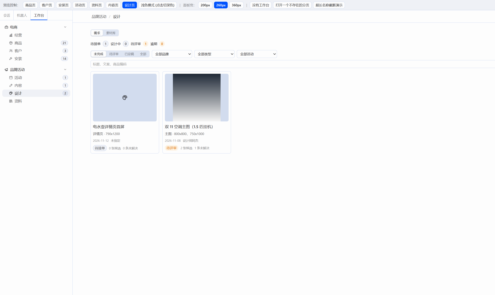
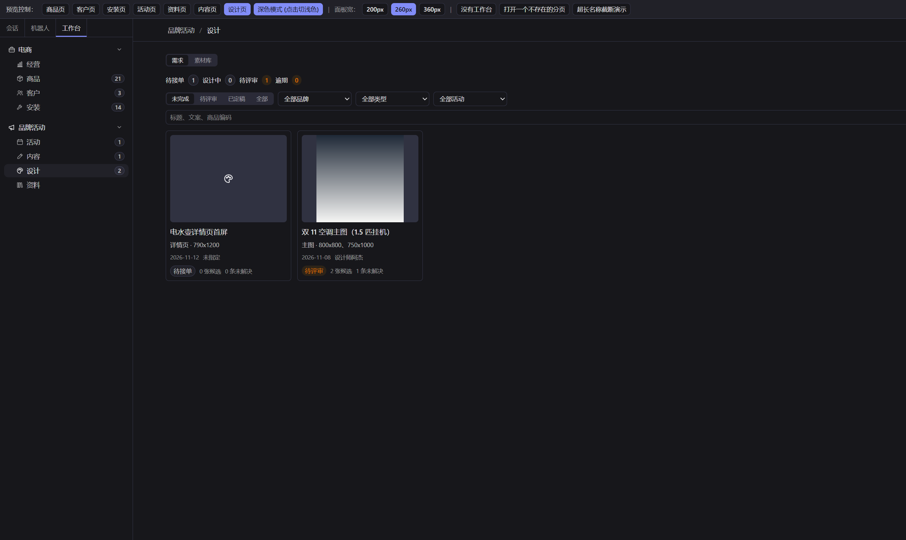
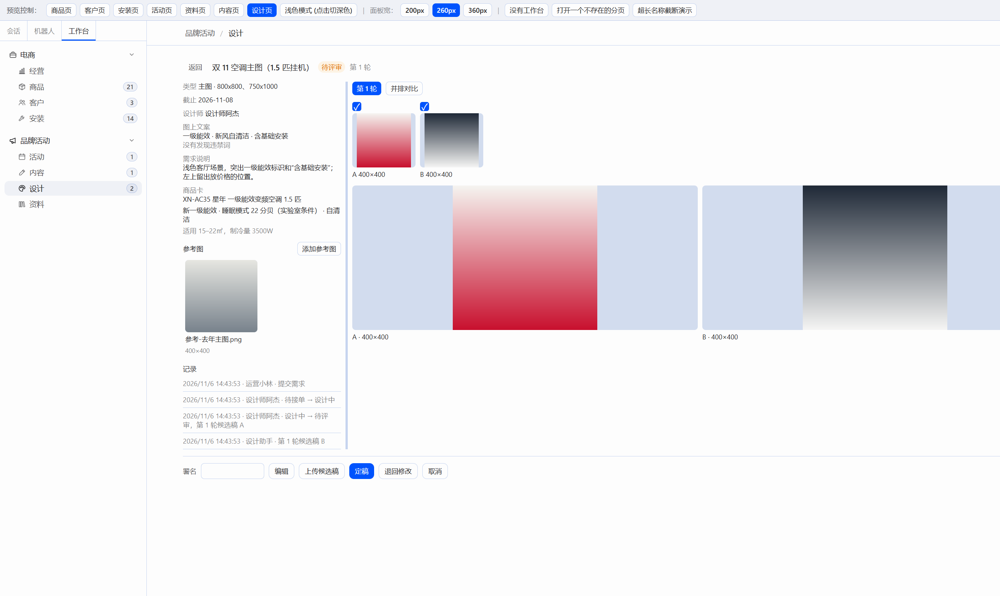
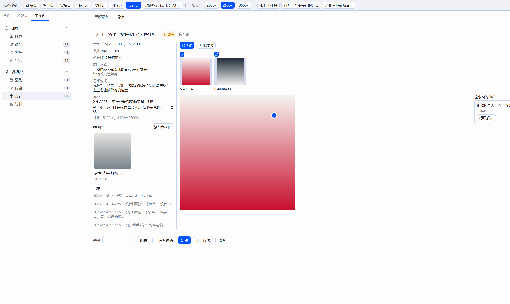
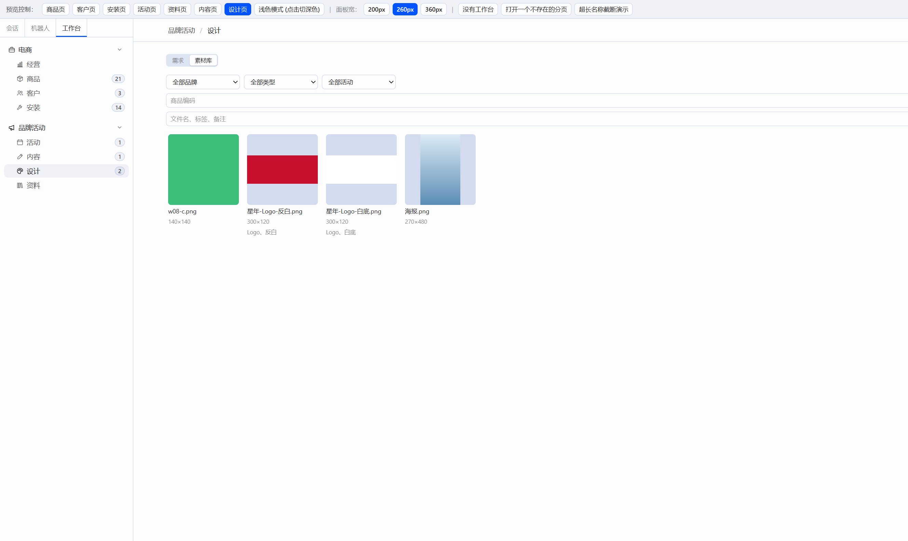
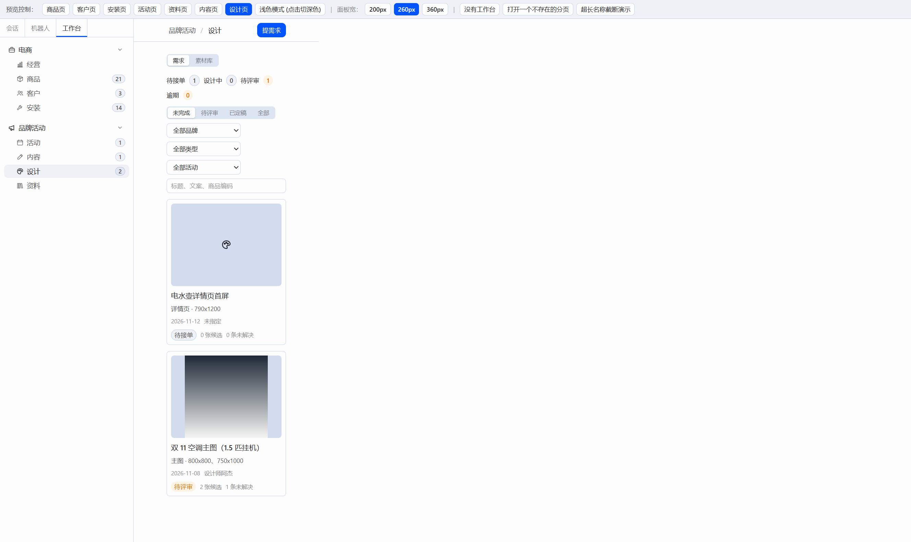

# W08 交付报告：设计页（接 C09 后端）

## 一、交付物与构建

只改了 `plugin/` 和本报告。`server/`、`docs/CONTRACT-*.md` 没有动。没有打开 Hermes 窗口。

| 文件 | 说明 |
|---|---|
| `plugin/src/api/design.ts` | 需求、候选稿、批注、定稿、素材库；上传走 `FormData`，原图不压缩 |
| `plugin/src/api/design-count.ts` | 左栏“设计”徽标：`needs_action`，60 秒刷新，失败不显示 |
| `plugin/src/pages/design/DesignPage.tsx` | 需求 / 素材库 |
| `plugin/src/pages/design/RequestDialog.tsx` | 提需求、编辑 |
| `plugin/src/pages/design/ReviewView.tsx` | 评审，左栏可拖宽 |
| `plugin/src/pages/design/PinLayer.tsx` | 图上的编号圆点 |
| `plugin/src/pages/design/AssetGrid.tsx` | 素材库和参考图共用的格子 |
| `plugin/src/pages/customers/labels.ts` | 复制兜底的文本框 |

图片地址是 `getApiBase()` 加上接口返回的 `/api/assets/{id}/file`。页面只用 `` 和下载链接，没有把图读进 canvas。批注点是绝对定位的圆，强调色填充、白描边。图的底色用 `--ui-bg-secondary`。没有加画布、标注或图片处理库。

构建（在 `plugin/` 下，2026-11-06）：

- `npm run build`：tsc 通过，vite 6.4.5 打出 88 个模块，`index-CWFcpCWT.js` 461.84 kB。
- `node build.mjs`：读到 `F:\Hermes改造\hermes-agent\apps\desktop\src\styles.css`，扫描 1490 个类名，写出 `plugin/dist/hermes-workbench/plugin.js`（446.5kb）。

## 二、先修

`copyText` 的兜底文本框改成 `position: fixed`、`left: -9999px`、`opacity: 0`，并在 `finally` 里移除。`execCommand` 抛错时也不会再留在页面底部。

## 三、预览走查

本机当时没有服务在听。演示库用的是已经生成好的 `server/data/demo.db`（3 条设计需求，素材库里定稿 1 张、直接上传 2 张），没有重建。服务开在 `http://127.0.0.1:8001`，资源目录是 `server/data/demo-assets`。预览开在 `http://localhost:5173/`，接口基址指到 8001。`:8000` 没有启动，也没有动。

左栏“设计”一开始是 2（待接单 1、待评审 1）。

走查：

- 提需求“W08 走查主图”，品牌星年，商品编码从商品卡搜出 XN-AC35，尺寸 `800x800`。文案写成“这是最佳的新风空调”，停半秒后框下红字：“最佳 · 必须修改，可改成「优秀」”。
- 带上一张参考图提交。评审页看到 `w08-reference.png`，120×120。记录是“王经理 · 提交需求”。
- 点接单。状态变成设计中，记录“待接单 → 设计中”，署名王经理。
- 一次上传两张候选稿。状态自己进了待评审，记录是“第 1 轮候选稿 A”“第 1 轮候选稿 B”，尺寸都是 160×160。
- 没勾候选稿就点定稿，按钮旁边是“请先勾选候选稿”。
- 打开 A，在图上写“右上角再亮一点”，保存后出现编号 1。点“标已解决”，右侧变成“王经理 · 已解决”。
- 退回修改不写说明，框不关，提示“请填写要改什么”。写上“右上角再亮一点，第二轮再出一张”后，页头变成第 2 轮，记录是“退回修改，进入第 2 轮：……”。第 1 轮的 A、B 还在。
- 再传一张，进入第 2 轮候选稿 A（140×140），状态回到待评审。
- 勾上这张再定稿。文案里还有“最佳”，按钮旁边是“图上文案有必须修改的违禁词：最佳”，状态仍是待评审。
- 编辑文案改成“这是优秀的新风空调”，提示变成“没有发现违禁词”。再定稿，状态是已定稿，图下有“下载原图”。
- 素材库里能看到这张 `w08-c.png`，旁边是原来的两张 Logo 和一张海报。打开海报，说明是“定稿”，只有保存和下载，没有删除。
- 上传 `w08-library.png`，标签“走查,临时”。打开后改成“走查,已改”，格子上跟着变。点删除后这张消失，定稿的 `w08-c.png` 还在。
- 左栏徽标：新建那条待接单时从 2 变成 3，定稿后回到 2。
- 内容区压到 360px 后，筛选和卡片改成一列。内容区 `scrollWidth` 等于 `clientWidth`，里面没有被撑出横向滚动的元素。截完把临时宽度清掉了。预览条上的“360px”按钮改的是左栏宽度，所以这张图是直接把内容区设成 360px 拍的。

另外打开了原来的“双 11 空调主图”看并排和批注：勾上 A、B 后两张一样高，下面是字母和宽高；点进 A，右上有编号 1，右侧是“能效标再大一点，放到右上”。演示库里这两张的 `source` 是 `upload`，所以没有“AI 生成”。接口若返回 `source=ai`，并排会标“AI 生成”，并折叠显示提示词。

## 四、截图

浅色需求：

深色需求：

并排对比：

大图和批注。窗口右边裁掉了一截，批注列表只露出开头，圆点在图的右上：

素材库：

窄窗口（内容宽 360px）：

## 五、借鉴

- Excalidraw：只看了图上的点怎么悬停出内容。圆点悬停显示批注正文。
- Penpot：只看了评论和已解决。点编号或“标已解决”把这条标掉，圆点变淡。
- Immich：只看了格子、筛选和大图。素材库是缩略图格子，点开抽屉看大图、改标签和备注。
- Hermes 看板：评审是整页，左上“返回”。素材详情用现成的 `SideDrawer`。

没有拷这些项目的代码，也没有加 `THIRD_PARTY.md`。

## 六、后端接口（只记录）

- 待接单或设计中时上传候选稿，服务端会把需求改成待评审。页面上设计中没有单独的“提交评审”按钮。
- 定稿只接受待评审，并且文案里不能有必须修改的违禁词。演示词表里“最佳”是必须修改，建议换成“优秀”。
- 素材库默认是定稿加直接上传的图。定稿删除会 409，页面上不放删除按钮。

## 审查结论（Claude）

通过。需求单、评审（A/B、并排对比、图上批注圆点）、素材库都按卡做齐；W07 的复制兜底已改成屏幕外 + finally 删除。构建通过。第六节三条是后端本来的规则，不用改。

小问题，放进 W09 开头：
- 评审页右侧“这张图的批注”栏贴在窗口最右边，和大图之间空出一大块，截图里批注正文被切掉（`w08-pins.png`）。批注栏应紧跟在大图右边（或和 W05 的批注栏一样固定宽度、可拖宽），宽窗口下不要被推到边上，内容不能被裁。
