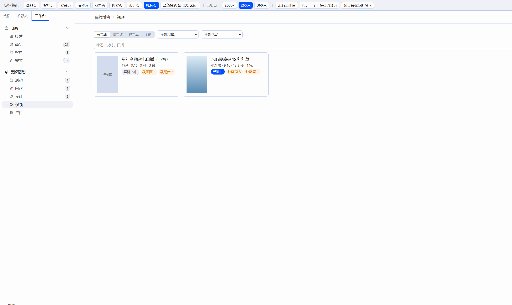
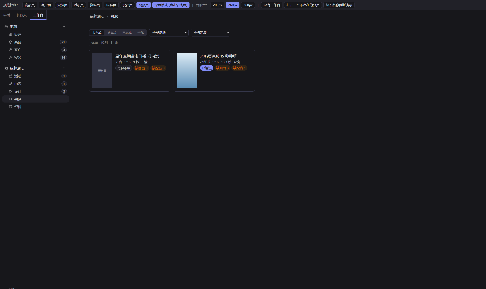
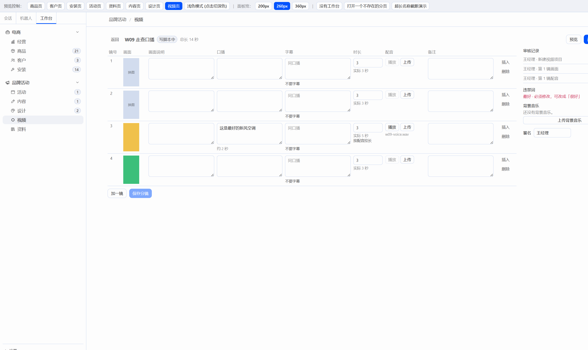
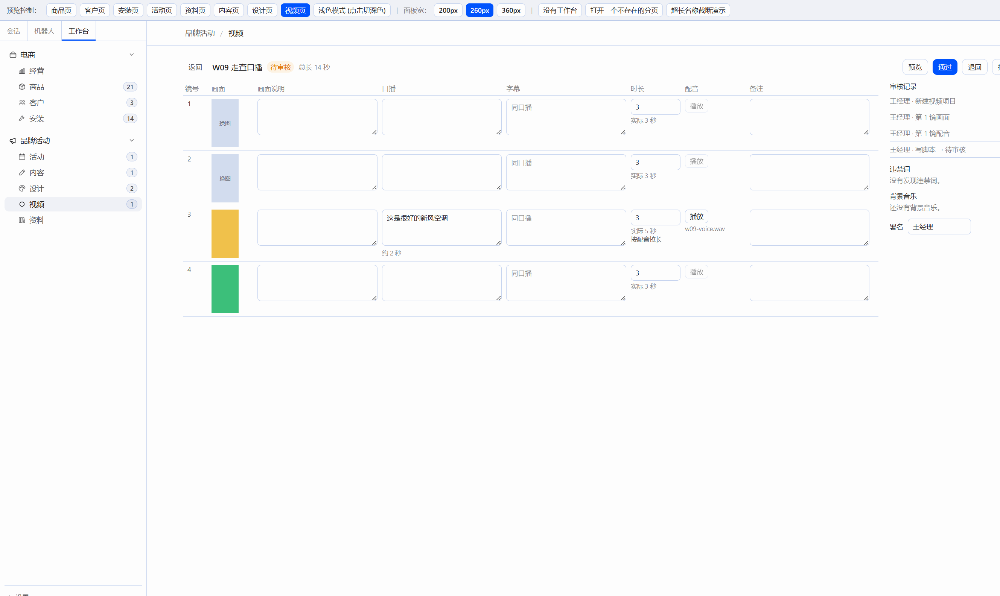
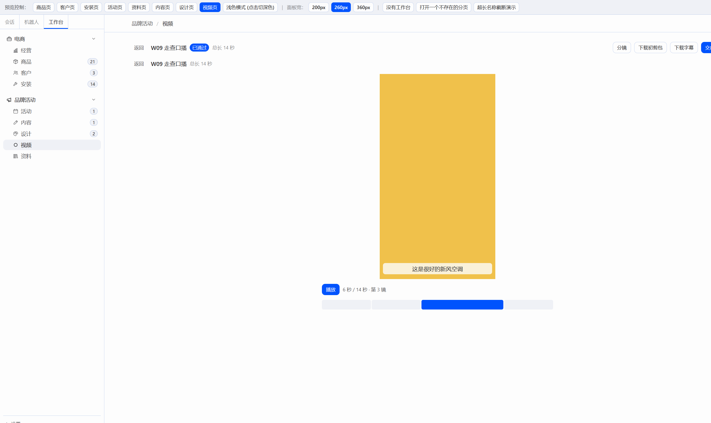
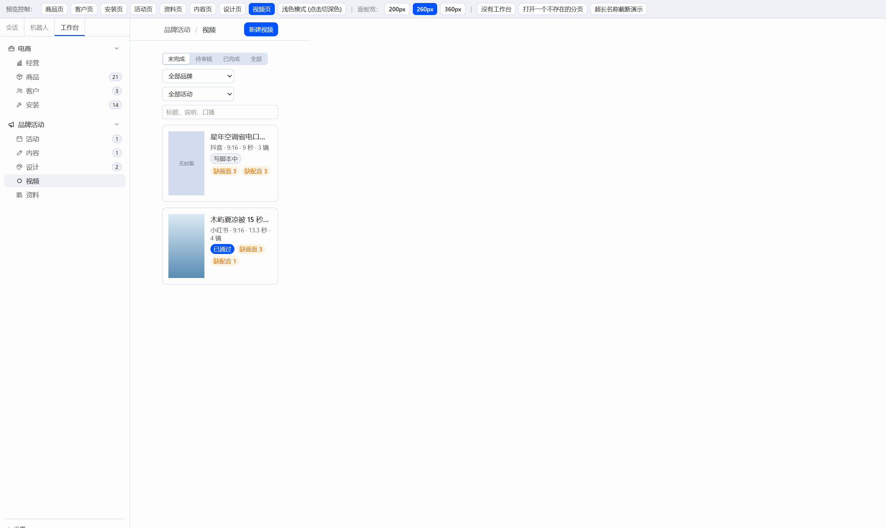
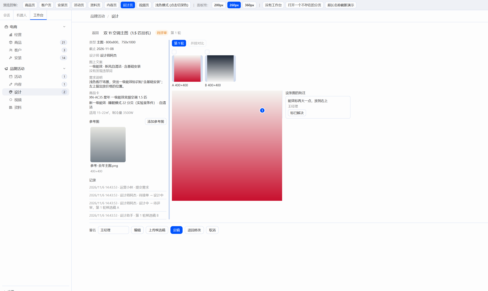

# W09 交付报告：视频页（接 C10 后端）

## 一、交付物与构建

只改了 `plugin/` 和本报告。`server/`、`docs/CONTRACT-*.md` 没有动。没有打开 Hermes 窗口。没有加视频编辑、波形或拖拽排序库，排序用的是 HTML5 原生拖放。预览只用 ``、`<video muted>`、`<audio>`。

| 文件 | 说明 |
|---|---|
| `plugin/src/api/video.ts` | 项目、分镜、上传、时间线、初剪包和字幕地址 |
| `plugin/src/api/video-count.ts` | 左栏“视频”徽标：`needs_action`，60 秒刷新，失败不显示 |
| `plugin/src/api/backup.ts` | 备份列表、立即备份、健康检查里的版本号 |
| `plugin/src/pages/video/VideoPage.tsx` | 列表和新建 |
| `plugin/src/pages/video/ScriptEditor.tsx` | 全宽分镜编辑 |
| `plugin/src/pages/video/ShotRow.tsx` | 一镜一行 |
| `plugin/src/pages/video/Preview.tsx` | 简易播放 |
| `plugin/src/pages/video/labels.ts` | 状态、平台、画幅、每秒 4.5 字 |
| `plugin/src/pages/WorkbenchSettings.tsx` | 后端地址、版本、数据备份 |
| `plugin/src/pages/design/ReviewView.tsx` | 批注栏贴着大图，可拖宽 |

`modules/brand.tsx` 在“设计”后面加了“视频”。工作台左栏底部的“设置”，以及连不上时“更改地址”里，都是同一块设置。画面和配音的地址是 `getApiBase()` 加上接口返回的路径。下载初剪包和字幕是新开标签，没有把文件读进页面。

构建（在 `plugin/` 下，2026-11-06）：

- `npm run build`：tsc 通过，vite 6.4.5 打出 97 个模块，`index-DmdWzUGg.js` 497.32 kB（gzip 137.74 kB），样式 `index-Dp3lmVe3.css` 29.22 kB。
- `node build.mjs`：读到 `F:\Hermes改造\hermes-agent\apps\desktop\src\styles.css`，扫描 1623 个类名，写出 `plugin/dist/hermes-workbench/plugin.js`（514.3kb）。

## 二、先修

设计评审页的“这张图的批注”紧挨大图右边。栏宽默认 260px，拖左边的分隔线可在 220–480px 之间改（向左拖变宽，和内容页批注栏同一套算法）。正文按词折行，栏内最高约 70vh，超出后自己滚动。窗口窄于 720px 时，批注改到大图下面。

打开原来的“双 11 空调主图”，点进候选稿 A：大图右缘和批注栏左缘对齐，栏宽 260px，正文“能效标再大一点，放到右上”整句都在栏里。这条批注仍是未解决。

## 三、预览走查

开始时 `127.0.0.1:8001` 上的进程是旧的：`/api/health` 只有 `status`，`/api/backup` 是 404。停掉后用现成的 `server/data/demo.db` 和 `server/data/demo-assets` 重新打开，调度关掉。没有重建演示库。`:8000` 没有启动，也没有动。预览开在 `http://localhost:5173/`，接口基址是 `http://127.0.0.1:8001`。重启后健康检查是 `{"status":"ok","version":"0.7.0"}`。

左栏“视频”一开始没有数字（待审核是 0）。

设置里能看到后端版本 0.7.0，备份目录 `F:\工作台开发\hermes-workbench\server\data\backups`，以及“每天 12:30 自动备份，位置可在 env.bat 里改”。点立即备份后列出 `demo-20261106-180436.db · 396.0 KB`，提示“已备份：demo-20261106-180436.db，新复制 17 个素材”。

走查新建的是“W09 走查口播”（id 3），品牌星年，平台抖音，画幅 9:16，商品编码从商品卡选出 XN-AC35，说明“走查用的短视频”，署名王经理。加了 4 镜。

- 第 1 镜上传画面 `w09-shot.png`。另一镜从素材库选了星年的 `w08-c.png`（绿块）。另外两镜缩略图仍是“换图”。
- 口播写成“这是最好的新风空调”，框下是“约 2 秒”（9 个字 / 4.5）。写的时长 3 秒。上传 `w09-voice.wav` 后实际时长变成 5 秒，这一行出现“按配音拉长”。总长 14 秒（3+3+5+3）。
- 拖“拖动第 4 镜”到“拖动第 1 镜”，带配音的那一镜从第 2 行移到第 3 行。改动留在本地，点“保存分镜”后才写回。
- 有未保存改动时上传画面或配音，提示先保存分镜。从素材库选图只改这一行的素材，随保存一起提交。
- 送审被拦，按钮下红字：“口播或字幕里有必须修改的违禁词：最好”。右侧栏是“最好 · 必须修改，可改成「很好」”。改成“这是很好的新风空调”后，栏里变成“没有发现违禁词”，再送审进入待审核。左栏变成“视频 1”。
- 待审核时表是只读的，没有加一镜、保存、插入、删除和上传。退回不写说明时框不关，提示“请填写要改什么”。这次走查点的是通过。
- 已通过后下载初剪包：zip，HTTP 200，`application/zip`，3014 字节，文件头是 `PK`。字幕 HTTP 200，开头是 `1`、`00:00:06,000 --> 00:00:11,000`、“这是很好的新风空调”。
- 预览按时间线播到第 3 镜：9:16 黄块，字幕“这是很好的新风空调”，进度落在第三段，总长 14 秒。配音在播。第 4 镜是绿块，没有字幕。
- 交成片上传 `w09-final.mp4`（`video/mp4`）。状态变成已完成，左栏徽标回到没有数字。

原来的两条还在：id 2“星年空调省电口播（抖音）”仍是写脚本中，id 1“木屿夏凉被 15 秒种草”仍是已通过。列表上能看到缺画面、缺配音的数量。

写脚本和待审核两张图的窗口右边裁掉了一截，送审、退回、撤回有一部分在画面外，和上一张报告里窗口裁切的情况一样。按钮在页面上，把窗口拉宽就能点到。

内容区压到 360px 后，筛选和卡片改成一列。卡片格子的最小宽度是 `min(100%, 16rem)`，内容区 `scrollWidth` 等于 `clientWidth`，里面没有被撑出横向滚动的元素。截完把临时宽度清掉了。预览条上的“360px”按钮改的是左栏宽度，所以这张图是直接把内容区设成 360px 拍的。

## 四、截图

浅色列表：

深色列表：

写脚本中的分镜表：

待审核，只读：

预览，第 3 镜：

窄窗口（内容宽 360px）：

批注栏贴着大图：

## 五、借鉴

- Remotion（自定义许可，只看布局）：时间线和预览器怎么摆。预览是一条按镜头分段的进度，画面在中间，字幕叠在下面。
- OpenCut（MIT，只看交互）：简易时间线和镜头列表。一镜一行，口播、画面、时长放在同一行。
- Excalidraw（MIT，只看手感）：拖动手柄换顺序。用的是浏览器自带的拖放。

没有拷这些项目的代码，也没有加 `THIRD_PARTY.md`。

## 六、后端接口（只记录）

- 只有写脚本中能改分镜、传画面和配音、换背景音乐，其他状态 409 `project_locked`。页面上非写脚本中整张表只读。
- 上传画面和配音的路径带镜号，这一镜得先保存才有序号。从素材库挑选只改本地的 `media_asset_id`。
- 送审至少要有 1 镜（`no_shots`）。标题、口播、字幕里有必须修改的违禁词时 400 `compliance_failed`。演示词表里“最好”必须改，建议“很好”。
- 退回必须写明要改什么（`note_required`）。合同允许从待审核和已通过退回；页面只在待审核放“退回”，和任务卡一致。
- 初剪包只在已通过或已完成时给，否则 409 `not_approved`。成片只收 MP4、MOV。文件头是 `ftyp` 且品牌不是 `qt` 或 `M4A` 时，按 `video/mp4` 收下。走查交的是一个很短的 `ftyp/isom` 盒子，接口接受了。
- `needs_action` 只计待审核，不含写脚本中和已通过。
- 实际时长取写的时长和配音秒数里更大的那个。WAV、MP3 能读出秒数；M4A、OGG 读不出，这种配音不会把镜头拉长。
- `subtitle` 不传表示和口播一样，传空字符串表示这镜不要字幕。
- 视频用的画面和配音是 `role=material`，不出现在素材库默认列表里。选图走的是带品牌的素材库。
- 合同里 `draft` 的名字是“写脚本”。任务卡和页面用“写脚本中”。

## 审查结论（Claude）

通过。分镜表、拖放排序、配音按秒数拉长、违禁词拦截、送审/通过、初剪包、预览、成片都按卡做齐；设计评审批注栏已紧贴大图，正文完整；设置里有版本号和数据备份。构建通过。第六节都是后端本来的规则，不用改。

一处小问题（W09.1，发 WK08 前顺手改）：
- 分镜页右侧栏（审核记录、违禁词、背景音乐、署名）和右上角主按钮被挤出窗口右边，`w09-script.png` 里“送审”按钮只露出一角，“上传背景音乐”也被裁。分镜表要能横向收缩（备注、画面说明列可以更窄或折到下一行），右侧栏固定宽度不被挤出；窗口窄时右侧栏移到表格下面。
