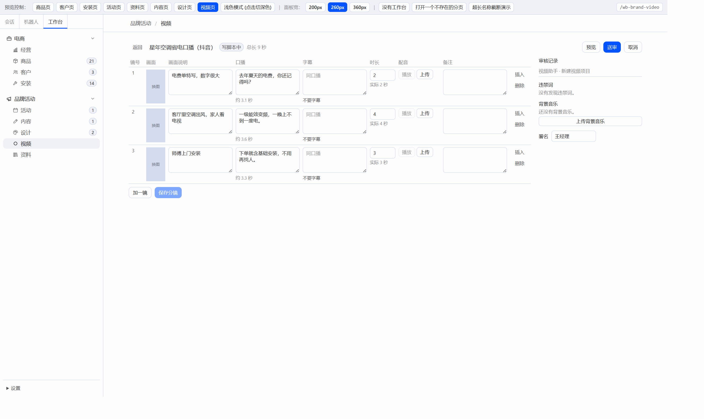
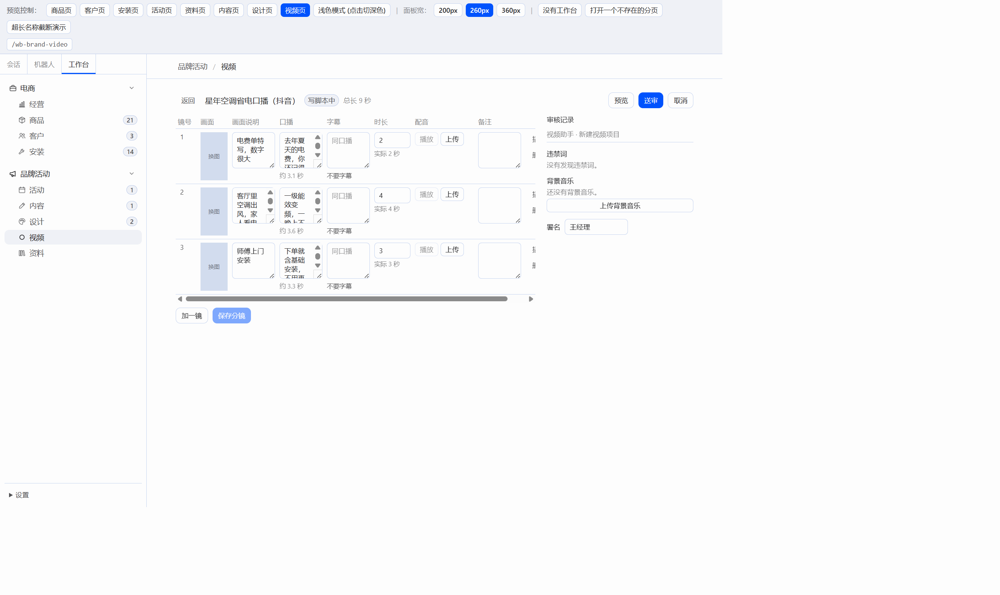
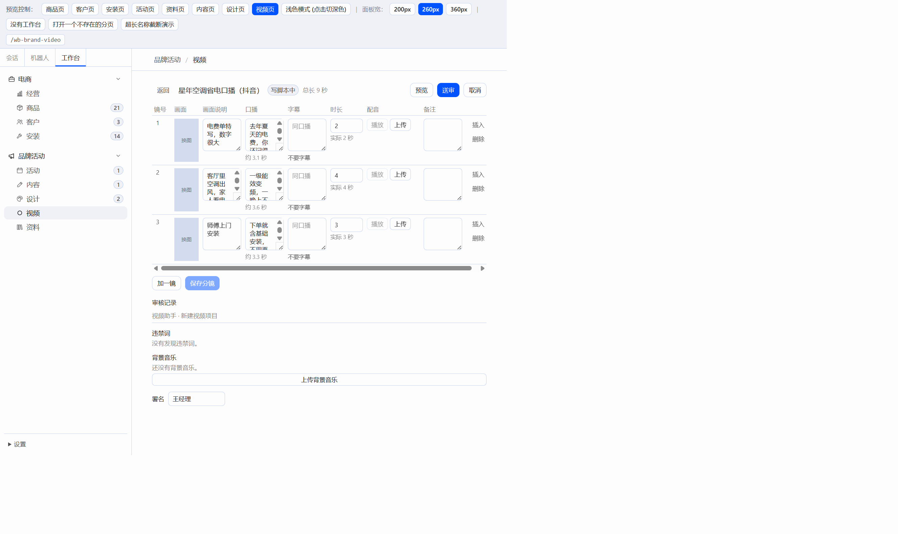

# W09.1 分镜页右侧栏

分镜表几列设了最小宽度，滚动容器又是弹性布局里的一项，最小宽度跟着表格内容走，整页被撑宽。右侧栏和右上角按钮跟着移出窗口。

改动只在 `plugin/src/pages/video/`。表格放进自己的横向滚动区，列宽按容器分配，画面说明、口播、字幕、备注可以收窄，文本框换行。表格最短 42rem，更窄时只在表格里滚动。右侧栏默认 260px，拖左边的分隔线可在 220–480px 之间改宽。内容区窄于 900px 时，右侧栏移到表格下面。

浅色，窗口 1680px。右侧栏在表格右边，预览、送审、取消都在窗口内：

窗口 1280px。内容区约 918px，右侧栏仍在旁边。表格自己出横向滚动条，页面没有被撑宽：

窗口 1000px。内容区约 660px，右侧栏在表格下面，上传背景音乐整颗按钮都在：

